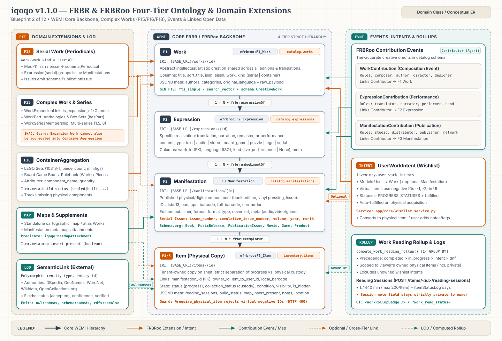
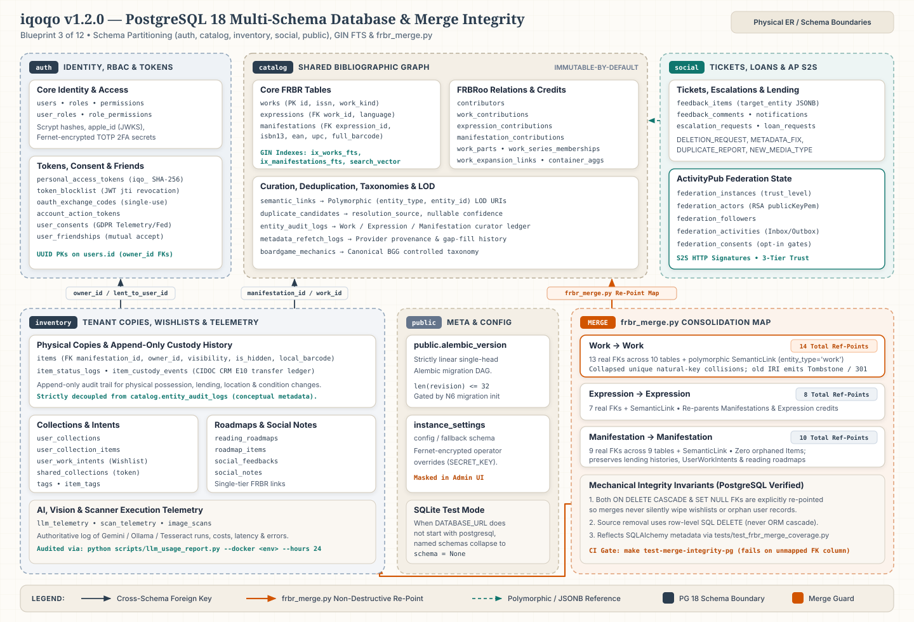
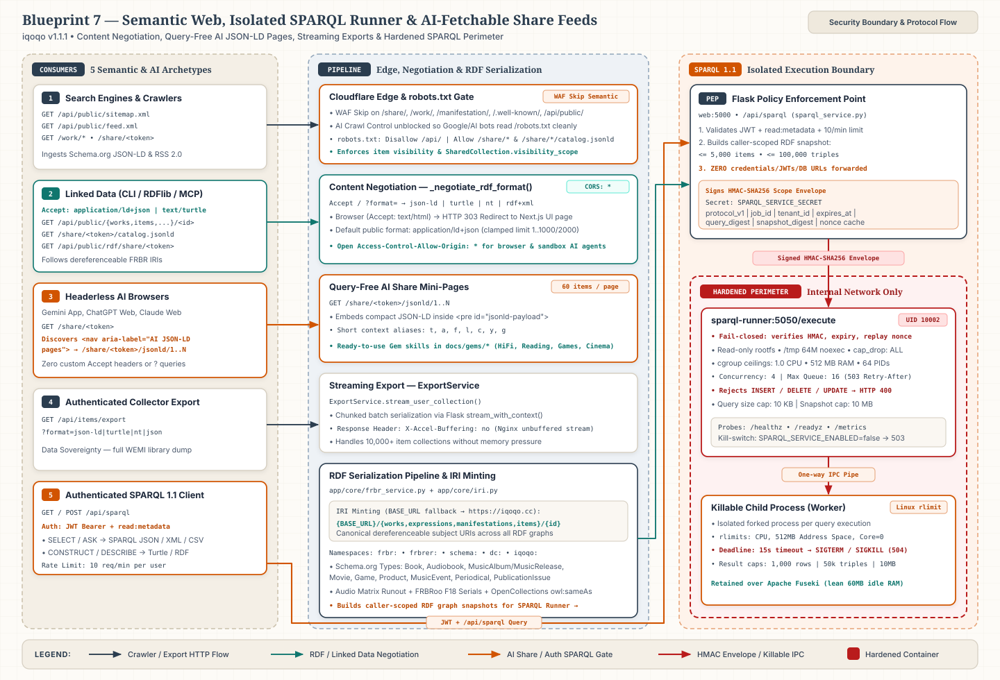
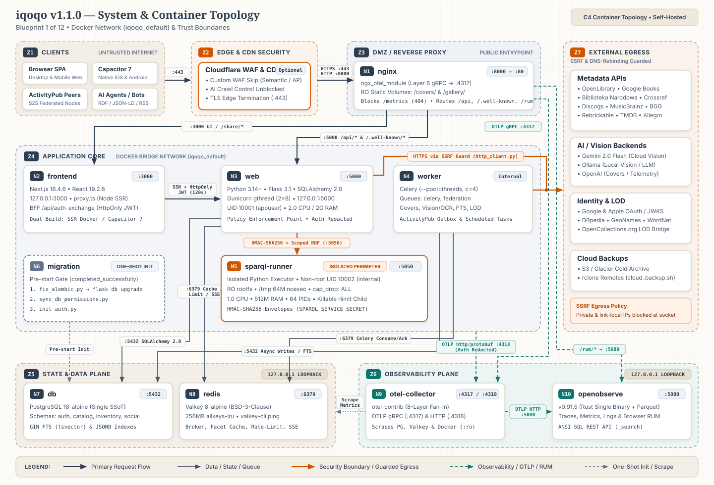
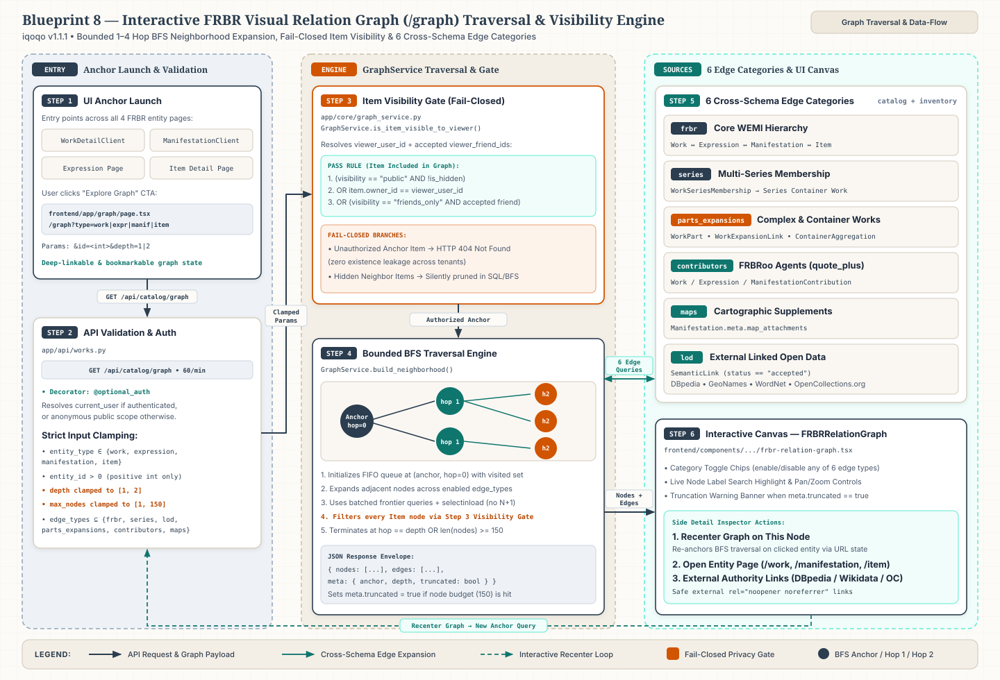
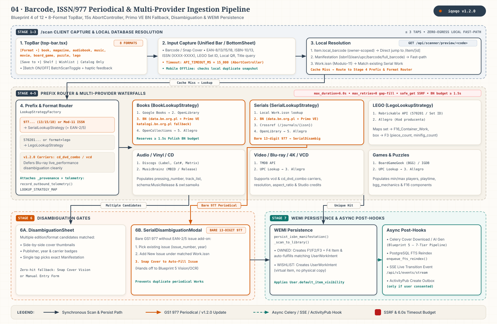
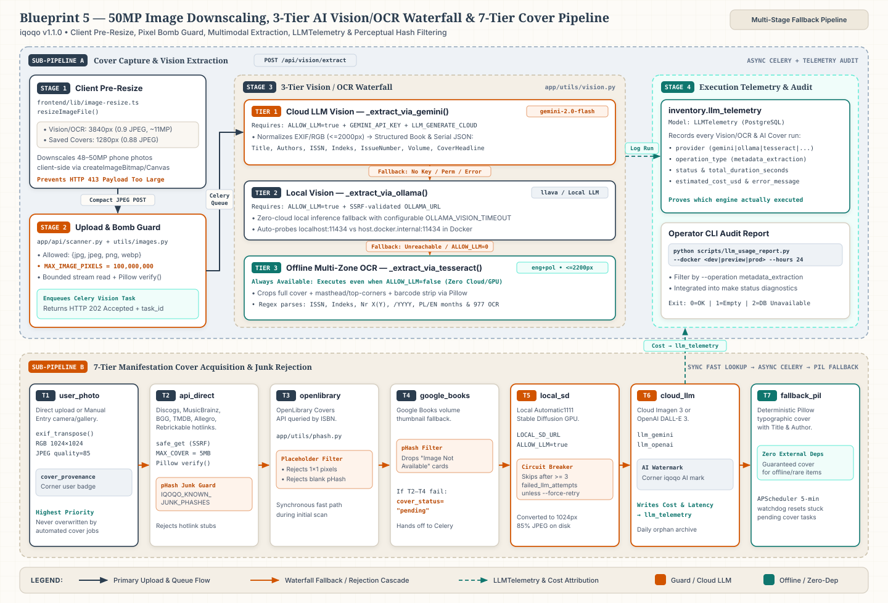
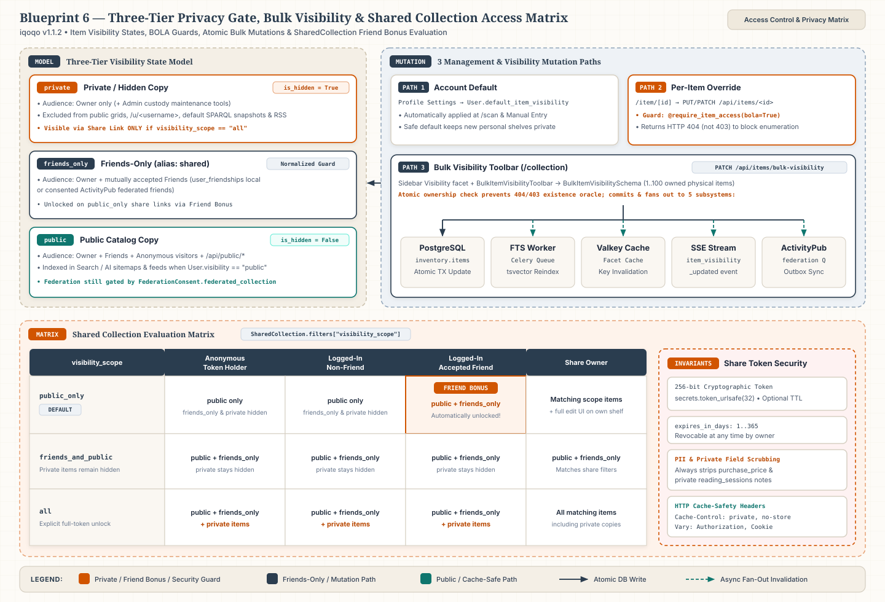
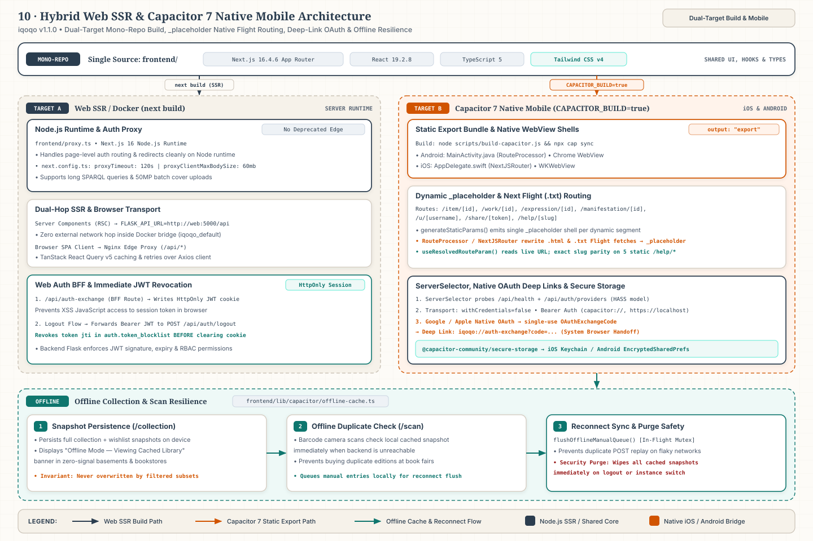

# iqoqo Architecture Guide

## 🏛️ Core Philosophy: FRBR-First Design

iqoqo is built on the **Functional Requirements for Bibliographic Records (FRBR)** model, specifically the FRBRoo (object-oriented) variant. This architecture ensures that bibliographic data is properly structured, deduplicated, and semantically meaningful.

## 📚 The FRBR Hierarchy

Every item in iqoqo exists within a strict four-tier hierarchy:

```text
Work (Concept)
  └── Expression (Version)
      └── Manifestation (Edition)
          └── Item (Physical/Digital Copy)
```



### 1. Work - The Abstract Concept

**Database**: `works` table

A Work represents the **abstract intellectual or artistic creation** - the story, the composition, the idea itself, independent of any particular realization.

**Example**: "The Hobbit" as a story concept

**Attributes**:

- `title` - The work's title
- `meta` - JSON containing:
  - `authors` - List of author names
  - `categories` - Subject classifications
  - `original_language` - Language of original creation

**Key Principle**: Multiple editions/translations of the same intellectual work share **one** Work entity.

```python
# One Work for all editions and translations
work = Work(
    title="The Hobbit",
    meta={
        "authors": ["J.R.R. Tolkien"],
        "categories": ["Fantasy", "Adventure"],
        "original_language": "en"
    }
)
```

### 2. Expression - The Specific Version

**Database**: `expressions` table

An Expression represents a **specific intellectual realization** of a Work - a particular text, translation, adaptation, or performance.

**Examples**:

- The English text of "The Hobbit"
- The German translation "Der Hobbit"
- The audiobook narration by Rob Inglis

**Attributes**:

- `work_id` - Foreign key to Work
- `content_type` - Type of content: 'text', 'audio', 'video', etc.
- `language` - ISO language code (e.g., 'en', 'de', 'pl')
- `meta` - JSON for additional expression-level data

**Key Principle**: Each language/format combination gets its own Expression, but they all point to the same Work.

```python
# English text expression
expression_en = Expression(
    work_id=work.id,
    content_type="text",
    language="en"
)

# German translation expression
expression_de = Expression(
    work_id=work.id,
    content_type="text",
    language="de"
)
```

### 3. Manifestation - The Physical/Digital Edition

**Database**: `manifestations` table

A Manifestation represents a **physical or digital embodiment** of an Expression - a specific published edition with its own ISBN, publisher, publication date, and physical characteristics.

**Examples**:

- 1937 Allen & Unwin hardcover first edition (ISBN: 9780048230706)
- 2012 Del Rey mass market paperback (ISBN: 9780345534835)
- 2020 Mariner Books illustrated edition (ISBN: 9780358653035)

**Attributes**:

- `expression_id` - Foreign key to Expression
- `isbn13` - ISBN-13 identifier (unique)
- `upc` - Universal Product Code
- `ean` - European Article Number
- `publisher` - Publisher name
- `publication_date` - Date of publication
- `meta` - JSON containing:
  - `imageLinks` - Cover image URLs
  - `pageCount` - Number of pages
  - `dimensions` - Physical size
  - `industryIdentifiers` - Other IDs

**Key Principle**: Each distinct ISBN represents a separate Manifestation, even if it's the "same book."

```python
# 1937 first edition
manifestation_1937 = Manifestation(
    expression_id=expression_en.id,
    isbn13="9780048230706",
    publisher="Allen & Unwin",
    publication_date=date(1937, 9, 21),
    meta={
        "pageCount": 310,
        "imageLinks": {"thumbnail": "..."}
    }
)

# 2012 paperback reprint
manifestation_2012 = Manifestation(
    expression_id=expression_en.id,
    isbn13="9780345534835",
    publisher="Del Rey",
    publication_date=date(2012, 1, 1)
)
```

### 4. Item - The Specific Copy

**Database**: `items` table

An Item represents **your specific copy** - the physical book on your shelf or the digital file you own, with its unique characteristics like condition, notes, and location.

**Examples**:

- The copy on your bookshelf with a coffee stain on page 47
- Your signed first edition
- Your Kindle version with highlights

**Attributes**:

- `manifestation_id` - Foreign key to Manifestation
- `owner_id` - User who owns this copy
- `status` - 'available', 'lent', 'lost', 'wish_list', 'reading', 'read'
- `condition` - 'new', 'like_new', 'good', 'fair', 'poor'
- `added_at` - When added to collection
- `meta` - JSON for user-specific data:
  - `notes` - Personal notes
  - `tags` - Custom tags
  - `location` - Shelf location
  - `purchase_date` - When acquired
  - `purchase_price` - What you paid

**Key Principle**: Multiple users can own the same Manifestation, but each has their own Item record.

```python
# Your specific copy
item = Item(
    manifestation_id=manifestation_2012.id,
    owner_id="user123",
    status="available",
    condition="good",
    meta={
        "notes": "Gift from Mom, 2023",
        "location": "Living room bookshelf, 3rd shelf",
        "tags": ["favorites", "fantasy"]
    }
)
```

### Virtual Wishlist Items (`UserWorkIntent`)

Wishlist items that do not yet have a specific physical copy (Item record) are represented as **virtual items** backed by the `UserWorkIntent` model.

- **Negative IDs**: In API responses and UI grids, virtual items use negative integer IDs (`-1`, `-2`, etc.) derived from the `UserWorkIntent` record to distinguish them from persistent physical `Item` records.
- **FRBR Tier**: `UserWorkIntent` models a user's intent or wish regarding a `Work` or `Manifestation` without instantiating an owned physical item copy.
- **Virtual-to-Physical Transition**: When a user modifies a virtual item (e.g., adding tags, setting shelf location, or changing condition), the backend automatically converts the `UserWorkIntent` into a true physical `Item` record with status `wish_list`, assigning a positive integer database primary key.

## 🔄 Data Flow and Relationships

### Querying Down the Hierarchy

To display a book in your collection, traverse from Item to Work:

```python

# Get owned items in user's collection with eager FRBR context
items = (
    db.session.execute(
        select(Item)
        .join(Manifestation)
        .join(Expression)
        .join(Work)
        .where(Item.owner_id == current_user.id)
    )
    .scalars()
    .all()
)

for item in items:
    # Access the full hierarchy
    title = item.manifestation.expression.work.title
    authors = item.manifestation.expression.work.meta.get("authors", [])
    isbn = item.manifestation.isbn13
    language = item.manifestation.expression.language
    condition = item.condition
```

### Creating New Entries: Work Deduplication

When adding a book, **always check if the Work already exists** to avoid duplicates:

```python
def add_book(isbn: str, metadata: dict) -> Item:
    """Add a book to collection, respecting FRBR hierarchy."""

    # 1. Check if Manifestation exists (by ISBN)
    manifestation = db.session.execute(select(Manifestation).where(Manifestation.isbn13 == isbn)).scalars().first()

    if not manifestation:
        # 2. Check if Work exists (by title)
        title = metadata["title"]
        authors = metadata["authors"]

        work = db.session.execute(select(Work).where(Work.title == title)).scalars().first()
        if not work:
            # 3. Create new Work
            work = Work(
                title=title,
                meta={"authors": authors}
            )
            db.session.add(work)
            db.session.flush()

        # 4. Create Expression for this language
        expression = Expression(
            work_id=work.id,
            content_type="text",
            language=metadata.get("language", "en")
        )
        db.session.add(expression)
        db.session.flush()

        # 5. Create Manifestation for this edition
        manifestation = Manifestation(
            expression_id=expression.id,
            isbn13=isbn,
            publisher=metadata.get("publisher"),
            publication_date=metadata.get("publication_date"),
            meta=metadata.get("extra_info", {})
        )
        db.session.add(manifestation)
        db.session.flush()

    # 6. Create Item (user's copy)
    item = Item(
        manifestation_id=manifestation.id,
        owner_id=current_user.id,
        status="available"
    )
    db.session.add(item)
    db.session.commit()

    return item
```

## 🔗 Duplicate Detection & FRBR Merge Integrity (v0.8.2)

The "check if the Work already exists" guidance above is still correct for
**ingest**, but it does not scale and it cannot repair a catalog that already
holds duplicates. Two modules own that problem, and the invariant between them
is the one to understand.

### `app/core/frbr_merge.py` — one map of what must move

Merging two FRBR entities is one operation with two halves: re-point every
reference, then drop the source. iqoqo had **two** implementations of that — a
manual merge endpoint and a duplicate-review queue — and they disagreed about
what a merge meant. The shared module answers "what must move when a Work,
Expression or Manifestation is consolidated" exactly once:

| Tier | Real foreign keys | Plus polymorphic | Total ref-points |
| ---- | ----------------- | --------------- | --------------- |
| Work | 19 across 13 tables | `SemanticLink` | 20 |
| Expression | 7 across 7 tables | `SemanticLink` | 8 |
| Manifestation | 9 across 9 tables | `SemanticLink` | 10 |

Three consequences worth knowing before editing it:

- **Both `ON DELETE CASCADE` and `SET NULL` links are re-pointed.** The cascade
  links would otherwise **silently destroy user data** — a wishlist row is not
  something a merge is entitled to delete — and the `SET NULL` links would be
  orphaned. Where a re-pointed row would collide with a natural-key unique
  constraint, it collapses onto the survivor instead of violating it.
- **The coverage is enforced mechanically.** `tests/test_frbr_merge_coverage.py`
  reflects the SQLAlchemy metadata for every foreign key targeting
  `works.id`, `expressions.id` or `manifestations.id`, and fails naming the
  offending `(model, column)` when one appears without a map entry or a
  justified exclusion. Adding a referencing column without updating the map is a
  test failure, not a production incident. It needs PostgreSQL
  (`make test-merge-integrity-pg`) because SQLite does not enforce foreign keys
  and therefore cannot see this class of defect at all.
- **Source removal is a row-level delete, never an ORM cascade.** Re-pointing a
  child by assigning its foreign key does **not** remove it from the parent's
  loaded collection, so a cascading ORM delete of the parent would delete the
  very row that was just migrated.

### `app/core/duplicate_service.py` — deterministic first, inference last

Screening produces candidate pairs; the classifier then assigns each pair exactly
one verdict **before** any model is consulted:

| Verdict | Condition |
| ------- | --------- |
| `AUTO_ACCEPT` | A shared edition-family identifier (`isbn13`/`ean`/`upc`/`barcode`), or an identical normalized title **and** a shared creator |
| `AUTO_REJECT` | A shared creator, but title similarity below the floor — same-author noise |
| `NEEDS_LLM` | Everything else: the only class eligible for inference |

A shared title alone is never `AUTO_ACCEPT`, because distinct works routinely
share one. The default engine is `heuristic`, so **a scan needs no inference
service running at all** — which also removes a GPU dependency from
containerized deployments. Measured on a production clone (2001 Works, 2058
Manifestations): 658 candidate pairs resolved into 40 queued, 144 auto-rejected
and 474 left explicitly undecided, with zero inference calls, in seconds rather
than the 1–6 hours the previous path needed at 9–45 s per pair.

`duplicate_candidates.resolution_source` records **which stage** decided each pair,
and `confidence` is nullable for the same reason: a rule verdict is categorical,
not probabilistic, so it must not be stored or displayed as `0.99` beside a
genuine model score of `0.99`.

Access is by **permission, not role** — listing needs `read:metadata`, and
scan/dismiss/merge need `write:metadata`. The `contributor` role holds every
`*:metadata` permission, so a curator gets the full workflow without being an
administrator.

## 🧭 Faceted Navigation & Cross-FRBR Filtering

iqoqo provides multi-dimensional faceted search and aggregated statistics via `DataManager.get_faceted_stats`:

- **Cross-FRBR Filtering**: Queries cross FRBR boundaries using optimized SQL subqueries. Filters applied at the Manifestation level (e.g., format, publisher) or Item level (e.g., status, condition) filter aggregate counts across the Work and Expression tiers without cross-join inflation.
- **FRBR-Level Count Distinctions**: Facet aggregations accurately distinguish between overall catalog counts, total Work items, unique Manifestations, and user-owned physical Items.
- **Multi-Select Facet Logic**: Facets enforce `AND` logic across distinct facet fields (e.g., `content_type=text AND status=available`) and `OR` logic within multiple selections of the same facet field (e.g., `format=Hardcover OR format=Paperback`).
- **Ownership Facet Navigation**: Dedicated "Ownership" facet enables filtering entities by `owned` vs `not_owned` status across the FRBR hierarchy:
  - _Item tier_: Direct physical ownership by user ID (`Item.owner_id == user_id`).
  - _Manifestation tier_: Whether user owns at least one physical item copy of that manifestation.
  - _Expression tier_: Whether user owns an item realizing that expression.
  - _Work tier_: Whether user owns any item under any expression of that work. Inverse `not_owned` selects items where the user has zero physical holdings in that subtree.
- **Publisher Metadata Extraction**: Publisher facets extract publisher strings across both relational fields and JSON metadata blobs using SQL `func.coalesce(Manifestation.publisher, Manifestation.meta['publisher'].as_string())` `# pylint: disable=not-callable` to ensure full coverage.
- **Public Facet Endpoint**: Statistics and facet counts are exposed via `/api/stats/facets` protected by `@optional_auth`, allowing public visitors to filter public collection views.

## 📊 Dashboard Query Scoping & Metric Aggregations

To support clear differentiation between personal libraries and the collective repository, dashboard endpoints support query scoping:

- **`scope=personal` (default)**: Restricts summary counts (`/api/stats`), reading velocity (`/api/profile/insights/velocity`), and media distribution (`/api/profile/insights/distribution`) to entities associated with the authenticated user's physical items or `UserWorkIntent` wishlist entries.
- **`scope=global`**: Computes system-wide catalog aggregates across all public/registered items and manifestations, useful for exploring the complete institutional collection.

## 💬 In-App Feedback & User Ticket Architecture

iqoqo includes a native in-app feedback and bug tracking mechanism (`/api/feedback` and `/feedback` UI):

- **Feedback Ingestion**: Authenticated users can submit bug reports, feature requests, or general feedback with optional screenshot attachments (`multipart/form-data` stored securely under `/static/gallery/`).
- **Role-Based Access Control (RBAC)**:
  - `tickets:creator`: Granted to standard `user` role to submit tickets and manage/close their own submissions.
  - `tickets:admin`: Granted to `admin` role to review all user submissions, update lifecycle statuses (`new`, `in_progress`, `resolved`, `closed`), and post custodian resolution notes.

## 🛠️ Implementation Guidelines

### DO: Respect the Hierarchy

✅ **Correct**: Query through relationships

```python
# Get title from Work through the hierarchy
title = item.manifestation.expression.work.title
```

❌ **Incorrect**: Store denormalized data

```python
# DON'T duplicate title in Item or Manifestation
item.title = "The Hobbit"  # Wrong!
```

### DO: Check for Existing Works

✅ **Correct**: Deduplicate by title

```python
work = db.session.execute(select(Work).where(Work.title == title)).scalars().first()
if not work:
    work = Work(title=title, meta={"authors": authors})
```

❌ **Incorrect**: Create duplicate Works

```python
# DON'T create a new Work for every book
work = Work(title=title, meta={"authors": authors})  # Might duplicate!
```

### DO: Use Proper Foreign Keys

✅ **Correct**: Link through IDs

```python
expression = Expression(work_id=work.id, ...)
manifestation = Manifestation(expression_id=expression.id, ...)
item = Item(manifestation_id=manifestation.id, ...)
```

### DO: Store Data at the Right Level

- **Work level**: Title, authors, subject matter, original language
- **Expression level**: Specific language, content type (text/audio/video)
- **Manifestation level**: ISBN, publisher, publication date, page count, cover images
- **Item level**: Ownership, condition, personal notes, shelf location

## 🧪 Testing FRBR Implementation

Every feature that touches the data model must have tests that verify FRBR compliance:

```python
def test_frbr_hierarchy():
    """Verify proper FRBR hierarchy is maintained."""
    # Create hierarchy
    work = Work(title="Test Book", meta={"authors": ["Test Author"]})
    db.session.add(work)
    db.session.flush()

    expression = Expression(work_id=work.id, content_type="text", language="en")
    db.session.add(expression)
    db.session.flush()

    manifestation = Manifestation(expression_id=expression.id, isbn13="9781234567890")
    db.session.add(manifestation)
    db.session.flush()

    item = Item(manifestation_id=manifestation.id, owner_id="user123")
    db.session.add(item)
    db.session.commit()

    # Verify relationships
    assert item.manifestation.expression.work.title == "Test Book"
    assert item.manifestation.expression.work.meta["authors"] == ["Test Author"]
```

See [tests/test_book_operations.py](../tests/test_book_operations.py) for comprehensive FRBR hierarchy tests, and [tests/test_ontology.py](../tests/test_ontology.py) for the ontology mapping.

## ⚙️ Operations, Ingestion & Maintenance

- **Metadata Resolution (`app/strategies/`, `app/utils/isbn.py`):** Multi-provider strategy registry routing barcodes, ISBNs, ISSNs/GS1 `977`, and LEGO set numbers across OpenLibrary, Google Books, Biblioteka Narodowa (`data.bn.org.pl` + Primo VE `katalogi.bn.org.pl` fallback), Crossref, OpenCollections.org, Allegro, BGG, Rebrickable, Discogs, MusicBrainz, IGDB, and TMDB (`requests.Session` bounded budgets + retries).
- **Cover & Vision Pipeline (`app/utils/vision.py`):** Client-side downscaling (`3840px` Vision/OCR, `1280px` cover), 100MP safety limit, 3-tier Vision/OCR fallback (**Gemini 2.0 Flash** -> **Ollama Vision** -> **Multi-Zone Tesseract `eng+pol`**), 7-tier cover sourcing, contributed `ImageScan` gallery (`ManifestationCoversGallery`), and `make fix-ai-covers`. See **[COVERS_SETUP.md](COVERS_SETUP.md)**.
- **Backups & Cold Archive:** Cloud backups via `scripts/cloud_backup.sh` (`pg_dumpall`, `covers/`, `gallery/`, `uploads/raw_covers/`, `data/keys/` + `data/federation_keys/`, compressed `.tar.gz`, synced via `rclone` or native boto3 `S3Service` to standard backups and S3 Glacier cold archives). See **[BACKUPS.md](BACKUPS.md)** and **[OPERATIONS.md](OPERATIONS.md)**.
- **Scheduled Watchdogs & Format Normalization:** APScheduler jobs (`app/core/scheduler.py`) bind explicit `with scheduler.app.app_context():` blocks. Format strings normalize through `shared/format_mappings.yaml` and `make fix-physical-kinds`; see **[INSTALL.md](INSTALL.md#data-curation)**.

## Authentication and Authorization (v0.1.0)

Iqoqo uses a hybrid authentication approach suitable for distributed deployments:

1. **SSO / Local Identity**: Users can register via standard email/password or use Google SSO (via Authlib).
2. **JWT & BFF Pattern**: The Python backend generates a stateless JWT and redirects the browser to the Next.js Backend-For-Frontend (BFF) route (`/api/auth-exchange`). That route handler catches the token and stores it securely in an `HttpOnly` cookie.
3. **Next.js Auth Guard (current behavior)**: A small helper used by protected routes (for example, `/collection`, `/profile`) checks for the presence of the auth cookie set by the BFF route before rendering pages. JWT signature and expiry verification are enforced on the Python backend; the Next.js layer currently treats the cookie as an opaque session token. A future iteration may introduce Edge middleware using `jose` for full client-side verification.
4. **RBAC**: The database implements an RBAC matrix (`Role`, `Permission`, `user_roles`). Backend API endpoints are protected using `@require_auth` and `@require_permission` decorators.

   > **Frontend RBAC and UI State:**
   > To ensure the user interface accurately reflects backend authorization rules (as tested in `test_api.py`), the frontend utilizes the `useProfile` hook which exposes `profile.permissions`. Components like `ItemActions` dynamically mount buttons based on the current user's permissions.
   >
   > **Note:** UI hiding is purely cosmetic; all associated API routes enforce strict validation on the backend.

5. **Data Privacy**: Granular GDPR consents (Telemetry, Federation) are tracked per user in the `user_consents` table with explicit opt-in mechanics.
6. **FRBR Boundary Enforcement (`@require_physical_item`)**: API endpoints operating on physical item features (e.g., updating physical condition or shelf location) use the `@require_physical_item` decorator. If invoked on a virtual item (negative ID / `UserWorkIntent`), the decorator intercepts the call before execution and returns a standardized `400 Bad Request` JSON error response:

   ```json
   {
     "error": "This action requires a physical item. Modify the wishlist item to convert it to a physical item first.",
     "code": 400
   }
   ```

7. **Hybrid Public/Authenticated Access (`@optional_auth`)**: Public catalog endpoints (such as `/api/manifestations` and `/api/stats/facets`) use `@optional_auth`. Unauthenticated visitors can browse global catalog stats and manifestations, while authenticated requests automatically resolve `current_user` to return personalized ownership flags and wishlist statuses.

## ⚙️ Operations & Maintenance

### Backup & Restore

iqoqo uses a cloud-first backup strategy via `scripts/cloud_backup.sh`, triggered by system cron.

**Backup:**

The cloud backup script performs a full disaster-recovery dump:

1. `pg_dumpall` of the PostgreSQL database (raw SQL)
2. Archives of asset directories: `covers/`, `gallery/`, `uploads/raw_covers/`
3. Compression into a single `.tar.gz`
4. Sync to an rclone cloud remote (S3, Google Drive, etc.)

- **Manual run:** `make backup-run remote=<rclone_remote_name>`
- **Install cron:** `make backup-install remote=<name>` — schedules daily at 03:00
- **Health check:** `make backup-check remote=<name>` — verifies cron, rclone, disk, freshness

**Ad-hoc JSON export (data portability):**
Run `make db-export` to export the database as JSON to `exports/backup.json`. This is useful for instance-to-instance data migration, not disaster recovery.

#### Background Scheduler

The in-app APScheduler (`app/core/scheduler.py`) runs a cover cleanup watchdog every 5 minutes to reset stuck cover tasks. Enable via `SCHEDULER_AUTOSTART=true`.

> **Flask Application Context**: Scheduled background jobs run outside HTTP request lifecycles. Functions executed by APScheduler (such as `run_scheduled_cover_cleanup()`) must explicitly create an application context using `with scheduler.app.app_context():` to safely access database sessions and application configuration without raising a `RuntimeError`.

### Format Normalization

External APIs (such as OpenLibrary, Google Books, or Discogs) return raw format strings that vary wildly (e.g., `"Mass Market Paperback"`, `"hardcover"`, `"Vinyl LP"`). iqoqo normalizes these into canonical `MediaFormat` identifiers:

- **Pipeline**: `app/core/format_normalizer.py` converts external string values into canonical `MediaFormat` enum values using `shared/format_mappings.yaml` as the git-tracked Single Source of Truth (SSoT).
- **Unknown Format Placeholders**: If an external format cannot be mapped, fallback placeholders (`unknown_video`, `unknown_audio`, `unknown_text`) are assigned to preserve dataset validity.
- **CLI Maintenance**: The `make fix-physical-kinds` CLI command audits existing physical items, flags non-canonical format entries, and interactively or automatically applies normalization mappings directly in the database (`--audit`, `--dry-run`, `--apply`).

**Restore:**
Run `python scripts/restore_covers.py <path_to_zip>` to restore cover images and update their metadata in the database.

- This script is "safe" — it updates existing records matching by ISBN/ID but does not wipe the database.
- **HINT:** On production run `docker compose exec web python scripts/restore_covers.py <path_to_zip>`

### Archiving Orphaned Covers

When books are deleted, their cover images remain on disk. To clean up:

```bash
python scripts/archive_orphans.py
```

This moves unused images to an archive folder.

- **Configuration:** Set `COVERS_ARCHIVE_DIR` env var to customize the archive location (default: `app/static/archive/covers`).

### Video / Film Metadata (FRBRoo Event-Based)

For video media (Blu-Rays, DVDs, VHS) the FRBR hierarchy leverages the existing Audio contributor models for Creation and Performance, but adds Publication events:

```text
Contributor  ←── ManifestationContribution  ←── Manifestation    (Publication Event)
```

Valid `ManifestationContribution.role` values: `studio`, `distributor`, `producer`, `network`.
Video-specific keys in `Manifestation.meta`: `resolution`, `aspect_ratio`, `video_format`, `audio_formats`, `run_time_minutes`.

### Board Game Metadata (FRBRoo Container Work)

Board games are modeled as an F16 Container Work (the Box) which aggregates distinct components:

```text
Work (The Box)  ←── ContainerAggregation  ──→ Work (Rulebook / Scenarios)
Work (The Box)  ←── ContainerAggregation  ──→ Item (Game Board / Pieces / Meeples)
```

Game-specific keys in `Manifestation.meta`: `min_players`, `max_players`, `playtime_minutes`, `min_age`, `game_mechanics`, `designer`.

### 5. F16 Container Work (Board Games)

**Database**: `catalog.container_aggregations` table (linking `works` and `items`)

For board games, iqoqo extends the basic FRBR hierarchy using the **FRBRoo F16 Container Work** pattern. A board game box is a container that holds multiple disparate items and works.

**Examples**:

- The "Catan" base game box.
- Inside the box: The Rulebook (F1 Work), The Game Board (F5 Item), 15 Road pieces (F5 Items).

**Attributes (`container_aggregations`)**:

- `container_work_id` - Foreign key to the main game's Work.
- `aggregated_type` - Type of component ('work' or 'item').
- `aggregated_work_id` / `aggregated_item_id` - Link to the specific rulebook or physical piece.
- `component_name` - "Red Meeples", "Main Board", etc.
- `quantity` - Number of identical pieces.

**Key Principle**: The main board game is an F16 Container. Its mechanics, min/max players, and playtime are stored in the Manifestation's `meta` JSON. The physical pieces and rulebooks are aggregated into this container, allowing users to track missing components.

```python
# Board Game as a Container
game_work = Work(title="Catan", meta={"categories": ["Board Game"]})

# Aggregating a rulebook
rulebook_work = Work(title="Catan Almanac")
aggregation1 = ContainerAggregation(
    container_work_id=game_work.id,
    aggregated_type='work',
    aggregated_work_id=rulebook_work.id,
    component_name="Almanac",
    quantity=1
)
```

## 🌐 Frontend Architecture (Phase 2)

iqoqo uses a **decoupled** architecture where the Flask application serves only JSON
via `app/api/` and the React/Next.js frontend is a fully independent application living
in `frontend/`.

### Technology Stack

| Layer        | Technology                             | Notes                          |
| ------------ | -------------------------------------- | ------------------------------ |
| Framework    | Next.js 16 (App Router)                | SSR + RSC hybrid               |
| Language     | TypeScript 5                           | Strict mode                    |
| Styling      | Tailwind CSS v4                        | CSS-based `@theme` config      |
| Server state | TanStack React Query v5                | Caching, retries               |
| HTTP client  | Axios                                  | Wraps `NEXT_PUBLIC_API_URL`    |
| Toasts       | Sonner                                 | Rich toast notifications       |
| Scanner      | ZXing (@zxing/browser, @zxing/library) | ISBN barcode via device camera |
| Fonts        | Merriweather (serif) + Inter (sans)    | Google Fonts                   |

### Design System – "Modern Athenaeum"

All design tokens live in `frontend/app/globals.css` as CSS custom properties mapped
into Tailwind v4 via `@theme inline`.

| Token                | Value                           | Usage                  |
| -------------------- | ------------------------------- | ---------------------- |
| `--color-primary`    | Deep Indigo `hsl(210 29% 24%)`  | Nav, headings, CTA     |
| `--color-accent`     | Library Clay `hsl(24 100% 41%)` | Accent, badges         |
| `--color-background` | Warm Paper `hsl(43 50% 98%)`    | Page background        |
| `--font-serif`       | Merriweather                    | Display text, headings |
| `--font-sans`        | Inter                           | Body, labels           |

### Directory Structure

```text
frontend/
├── app/                   # Next.js App Router
│   ├── globals.css        # Design system tokens (Tailwind v4 @theme)
│   ├── layout.tsx         # Root layout + Providers
│   ├── page.tsx           # Dashboard (/)
│   ├── collection/
│   │   └── page.tsx       # Collection browser
│   ├── item/[id]/
│   │   └── page.tsx       # Item detail
│   └── scan/
│       └── page.tsx       # Barcode scanner
├── components/
│   ├── dashboard/         # Navbar, StatsCards, CurrentContext, FreshArrivals
│   ├── collection/        # ItemCard, FilterBar, SidebarFilters, CollectionGrid
│   ├── item/              # HeroBanner, ItemHeader, ItemSidebar, ItemTabs
│   └── scanner/           # TopBar, Viewfinder, BottomSheet, SuccessCard
├── lib/
│   ├── utils.ts           # cn() class merging helper
│   └── api/
│       ├── client.ts      # Axios instance + apiFetch() helper
│       └── hooks.ts       # React Query hooks for all endpoints
└── types/
    └── frbr.ts            # TypeScript types mirroring the FRBR data model
```

### API Integration Pattern

The frontend communicates with Flask via a standardised JSON envelope:

```jsonc
// Every endpoint returns this shape
{
  "success": true,
  "data": {
    /* entity or list */
  },
  "error": null, // string when success=false
  "meta": {
    // present on paginated endpoints only
    "page": 1,
    "limit": 20,
    "total": 1562,
    "pages": 79,
  },
}
```

The `apiFetch<T>()` helper in `lib/api/client.ts` unwraps this envelope and throws
a typed error when `success` is `false`.

### Item Status Values

The `Item.status` column accepts exactly these values. The canonical Python
definition is `ITEM_STATUSES` in `app/db/core.py`; the TypeScript mirror is
`ItemStatus` in `frontend/types/frbr.ts`. The cross-subsystem contract is
enforced by `tests/test_ontology.py`.

| Status           | Meaning                            | Media |
| ---------------- | ---------------------------------- | ----- |
| `available`      | On your shelf, ready to use        | All   |
| `lent`           | Lent to a friend                   | All   |
| `lost`           | Cannot be located                  | All   |
| `wish_list`      | Want to acquire (owned or not)     | All   |
| `ordered`        | Purchased, awaiting delivery       | All   |
| `damaged`        | Physically damaged copy            | All   |
| `reading`        | Currently being read               | Text  |
| `read`           | Finished reading                   | Text  |
| `unread`         | Never opened                       | Text  |
| `listening`      | Currently playing / listening to   | Audio |
| `listened`       | Finished listening                 | Audio |
| `want_to_listen` | On audio wishlist (do not own yet) | Audio |

### Database Schema Layout



Tables are split across PostgreSQL schemas:

| Schema | Tables |
| --- | --- |
| `auth` | `users`, `roles`, `permissions`, `user_roles`, `role_permissions`, `token_blocklist`, `user_consents` |
| `catalog` | `works`, `expressions`, `manifestations`, `contributors`, `work_contributions`, `expression_contributions`, `manifestation_contributions`, `work_parts`, `work_series_memberships`, `work_expansion_links`, `work_relations`, `boardgame_mechanics`, `container_aggregations`, `image_scans`, `reading_roadmaps`, `roadmap_items`, `tags` |
| `inventory` | `items` (includes `physical_location`), `item_custody_events`, `item_status_logs`, `entity_audit_logs`, `duplicate_candidates`, `escalation_requests`, `loan_requests`, `metadata_refetch_log`, `work_link_candidates`, `shared_collections`, `shared_collection_items`, `llm_telemetry`, `scan_telemetry` |
| `social` | `feedback_items`, `feedback_comments`, `notifications` |
| `federation` | `federation_instances`, `federation_actors`, `federation_followers`, `federation_activities`, `federation_consents` |
| `config` | `instance_settings` (Fernet-encrypted external API credentials & OAuth tokens) |
| `public` | `alembic_version` |

### Model File Structure

Model classes live in domain-focused modules under `app/db/`:

| File | Contents |
| --- | --- |
| `auth.py` | `User`, `Role`, `Permission`, `TokenBlocklist`, `ConsentRecord` |
| `core.py` | `Work`, `WorkRelation`, `WorkLinkCandidate`, `WorkExpansionLink`, `BoardgameMechanic`, `Expression`, `Manifestation`, `ImageScan`, `Item`, `ItemStatusLog`, `ItemCustodyEvent`, `EntityAuditLog`, `SemanticLink`, `UserWorkIntent`, `ITEM_STATUSES` |
| `contributions.py` | `Contributor`, `WorkContribution`, `ExpressionContribution`, `WorkPart`, `WorkSeriesMembership`, `ManifestationContribution` |
| `games.py` | `ContainerAggregation`, `MANIFESTATION_GAME_META_KEYS` |
| `social.py` | `SharedCollection`, `SharedCollectionItem`, `FeedbackItem`, `FeedbackComment`, `EscalationRequest`, `LoanRequest`, `Notification` |
| `federation.py` | `FederationInstance`, `FederationActor`, `FederationFollower`, `FederationActivity`, `FederationConsent` |
| `roadmap.py` | `ReadingRoadmap`, `RoadmapItem` |
| `settings.py` | `LLMTelemetry`, `ScanTelemetry`, `InstanceSettings` |
| `models.py` | Re-export shim — `from app.db.models import Work` continues to work |

### Item Custody & Entity Audit Logs

To maintain strict ontological separation between physical item possession and conceptual metadata changes, iqoqo implements CIDOC CRM-aligned audit tables in the `inventory` schema (`app/db/core.py`):

- **`ItemCustodyEvent` (`inventory.item_custody_events`):** Append-only audit log tracking physical Item tier transfers, location changes, lending events, and condition alterations.
- **`EntityAuditLog` (`inventory.entity_audit_logs`):** Tracks editorial curation, metadata updates, deduplication merges, and provenance changes at the Work, Expression, and Manifestation tiers.

### Board Game Expansions (F15 Complex Work Decomposition)

Starting in **v0.7.16**, board game expansions are modeled as distinct `F1_Work` entities linked to their base game via `work_expansion_links`:

```text
Base Game (Work)  ←── WorkExpansionLink (is_expansion_of) ──  Expansion (Work)
```

- **Ontology Alignment**: Reifies `iqoqo:is_expansion_of` and its inverse `iqoqo:has_expansion` in `docs/ontology/iqoqo.ttl`.
- **SHACL Integrity Guard**: Defined in `docs/ontology/iqoqo-shapes.ttl` and enforced at runtime via `validate_work_not_expansion_aggregated()`. A Work linked as an expansion cannot be aggregated as a component into an F16 Container Work box (`container_aggregations`).

### Board Game Mechanics Taxonomy

Board game mechanics use a canonical controlled vocabulary backed by `boardgame_mechanics` in the `catalog` schema:

- **Data Source**: Seedable canonical JSON located at `data/bgg_mechanics.json`.
- **API Endpoint**: `GET /api/taxonomies/boardgame-mechanics` returns the structured list of mechanics.
- **Frontend Component**: Rendered uniformly via the `MechanicBadge` component.

### Audio / Music Metadata (FRBRoo Event-Based)

For audio media (CDs, Vinyls, Audiobooks) the FRBR hierarchy is extended

with FRBRoo event-based contributor tables in the `catalog` schema:

```text
Contributor  ←── WorkContribution  ←── Work          (Composition Event)
Contributor  ←── ExpressionContribution ←── Expression  (Performance Event)
Work  ←── WorkPart ←── Work                           (F15 Complex Work — box sets)
```

Valid `WorkContribution.role` values: `composer`, `lyricist`, `author`, `playwright`, `arranger`

Valid `ExpressionContribution.role` values: `performer`, `conductor`, `narrator`, `band`, `director`, `ensemble`

Audio-specific keys that **may** be stored in `Manifestation.meta`:

| Key               | Type    | Description                                                   |
| ----------------- | ------- | ------------------------------------------------------------- |
| `catalog_number`  | string  | Record-label catalog number (e.g. `"ECM 1064"`)               |
| `pressing_number` | string  | Specific pressing identifier                                  |
| `matrix_number`   | string  | Vinyl run-out groove / lacquer ID                             |
| `label`           | string  | Record label name (e.g. `"Blue Note"`)                        |
| `format`          | string  | Physical format: `LP`, `45`, `EP`, `CD`, `CD-EP`, …           |
| `disc_count`      | integer | Number of discs in a multi-disc release                       |
| `track_list`      | list    | `[{"position": "A1", "title": "…", "duration_seconds": 210}]` |

### Local Development

```bash
# Start PostgreSQL, Flask API (:5000), and Next.js frontend (:3000):
docker compose up -d db
./run.sh dev
```

See [docs/INSTALL.md](INSTALL.md) for full setup instructions.

## 🌐 Semantic Web Layer

iqoqo transforms the FRBR-modeled collection into a queryable, interoperable Linked Data source:



- **Isolated SPARQL Execution (`app/api/sparql.py`, `app/core/sparql_service.py`, `sparql-runner`):** Read-only `GET`/`POST /api/sparql` (`10/min`, `10 KB` max query, `15s` timeout, concurrency `4`, `5,000` items / `100,000` triples cap) executed inside the isolated Python RDFLib `sparql-runner` container over HMAC-SHA256 signed envelopes.
- **Public Linked Data & Dereferenceable IRIs (`app/api/public_rdf.py`, `app/core/iri.py`):** Open-CORS JSON-LD, Turtle, N-Triples, RSS feeds, sitemaps, and `/share/<token>/jsonld/1..N` (`60` items/page) mini-pages resolving `{BASE_URL}/works|expressions|manifestations|items/{id}` (`BASE_URL` -> `NEXT_PUBLIC_FRONTEND_URL` -> `https://iqoqo.cc`), with HTML requests returning `303` redirects.
- **RDF Serialization & Export (`app/core/frbr_service.py`, `app/core/export_service.py`):** Emits `frbr`, `frbroo`, `frbrer`, `schema`, `dc`, `owl`, `skos`, and `iqoqo` triples (including `frbroo:R2_is_derivative_of` for `WorkRelation`, `vcd`/`cd_dvd_combo` Schema.org types, and owner-authorized `iqoqo:physicalLocation`), plus chunked `/api/items/export` streaming. See **[Semantic Web Guide](SEMANTIC_WEB.md)** and **[API Reference](API.md)** for complete vocabulary tables, SPARQL examples, and content-negotiation headers.

## 📖 Further Reading

- **FRBRoo Specification**: [https://www.ifla.org/publications/node/11240](https://www.ifla.org/publications/node/11240)
- **FRBR Family**: [https://www.ifla.org/frbr](https://www.ifla.org/frbr)
- **iqoqo Ontology**: [docs/ontology/iqoqo.ttl](ontology/iqoqo.ttl)
- **[Semantic Web Guide](SEMANTIC_WEB.md)** — SPARQL queries, Linked Data, and exports
- **[API Reference](API.md)** — Complete endpoint documentation
- **[Operations Runbook](OPERATIONS.md)** — FRBR ETL and ontology sync

## 🤝 Questions?

If you're unsure about where data should live in the FRBR hierarchy:

1. Ask: "Is this about the **concept** (Work), the **version** (Expression), the **edition** (Manifestation), or **my copy** (Item)?"
2. Check the [models.py](../app/db/models.py) documentation
3. Look at existing tests in [tests/test_book_operations.py](../tests/test_book_operations.py)
4. Open an issue for discussion

Remember: **When in doubt, follow the hierarchy!**

## 👥 Social & Privacy Architecture (v0.7.0+)

Phase 1 of v0.7.0 introduces opt-in social features while maintaining strict user privacy.

### 1. Opt-in Exposure

- **`User.visibility`**: Reuses the existing `visibility` field. Only users with `visibility="public"` are discoverable via `/u/[username]`.
- **`User.public_username`**: A unique, customizable handle used for public URLs.
- **`User.bio`**: Optional public text for personalized profiles.

### 2. Item-Level Privacy

- **`Item.is_hidden`**: A granular toggle. Even if a profile is public, specific items can be hidden from the public grid.
- **BOLA Protection**: All visibility toggles verify `owner_id`. Unauthorized access attempts return `404 Not Found` rather than `403 Forbidden` to prevent account enumeration.

### 3. Dynamic Shared Collections

- **`SharedCollection`**: Stores a secure `share_token` linked to a set of JSONB filters (e.g., `{"status": "wish_list"}`).
- **Access**: Shared collections are accessible to anyone with the token, bypassing the general profile visibility if the specific collection was shared.

### 4. Smart Inventory Discovery

- **"Check if I have it"**: A visitor-facing tool that searches the joined FRBR chain (`Item` → `Manifestation` → `Expression` → `Work`).
- **Logic**: If an exact match is found in the owner's collection, it returns the Item details. If not owned but exists in the global catalog, it returns the Manifestation details to indicate the item is known to iqoqo.

### 5. Shared Collection UI Patterns

- **Token-Based Access**: Shared collections operate via unique `share_token` URLs, granting read-only access to specific filtered items without exposing account details.
- **Simplified Navigation**: When viewing a shared collection, the frontend renders a simplified top navbar without personal collection navigation or administrative controls.
- **Hidden Action Buttons**: Interactive item controls (edit, delete, status toggle, tag modification) are hidden for unauthenticated viewers of shared links.

### 6. Feedback & Escalation Subsystem (v0.7.15 - v0.7.16)

- **Dedicated Social Schema**: Feedback models (`FeedbackItem`, `FeedbackComment`) reside in PostgreSQL `social` schema with relational normalization for thread comments.
- **FRBR Target Entity Linkage**: `FeedbackItem.target_entity` (JSONB) links user bug reports directly to specific FRBR entities (`{"entity_type": "manifestation", "entity_id": 123}`), bridging user feedback with custodian escalation queues (`DELETION_REQUEST`, `METADATA_FIX`, `DUPLICATE_REPORT`, `NEW_MEDIA_TYPE`).
- **Attachment Storage**: Feedback attachments are stored locally under `app/static/gallery/` on a host bind mount and included in nightly off-site backups (`scripts/cloud_backup.sh`).

---

## 🏗️ Platform Architecture & Domain Extensions (v1.0.x – v1.2.0)

### 1. System & Container Topology



| Container / Service | Port Binding | Engine & Role | Key Constraints & Boundaries |
| :--- | :--- | :--- | :--- |
| `nginx` (`deploy/Dockerfile.nginx`) | `${NGINX_PORT:-8000}:80` | Reverse proxy with `ngx_otel_module` (Layer 6 gRPC OTLP to `:4317`) | Serves static `/covers/` and `/gallery/` RO volumes; routes `/api/*` + `/.well-known/*` to `web:5000`, `/rum/*` to `openobserve:5080`, rest to `frontend:3000`; blocks `/metrics` (`404`) |
| `frontend` | `127.0.0.1:${FRONTEND_PORT:-3000}:3000` | Next.js `16.4.6` App Router + React `19.2.8` (`proxy.ts` Node runtime) | BFF `/api/auth-exchange` writes `HttpOnly` cookie; SSR fetches `web:5000/api` (`proxyTimeout: 120s`, `60mb` max body); dual builds support SSR Docker or Capacitor 7 static export |
| `web` | `127.0.0.1:${WEB_PORT:-5000}:5000` | Python `3.14+`, Flask `3.1`, Gunicorn (`gthread`, 2 workers x 8 threads) | UID `10001` (`appuser`); instrumented with OTLP `http/protobuf` (`:4318`) and `Authorization` span redaction |
| `worker` | Internal | Celery worker (`celery`, `federation` queues, `--pool=threads`, concurrency `4`) | Handles covers, AI Vision/OCR, FTS reindex, LOD & cross-media reconciliation, ActivityPub outbox delivery, scheduled cleanup |
| `sparql-runner` | Internal `:5050` | Isolated Python RDFLib SPARQL executor (`deploy/Dockerfile.sparql`) | UID `10002`, read-only rootfs, `cap_drop: ALL`, `512m` RAM, `64` PIDs, HMAC-SHA256 signed envelopes (`SPARQL_SERVICE_SECRET`) |
| `db` | `127.0.0.1:${DB_PORT:-5432}:5432` | PostgreSQL `18-alpine` | Single source of truth across `auth`, `catalog`, `inventory`, `social`, `federation`, `config`, and `public` schemas |
| `redis` | `127.0.0.1:${REDIS_PORT:-6379}:6379` | **Valkey `8-alpine`** (`valkey/valkey:8-alpine`, `--maxmemory 256mb --maxmemory-policy allkeys-lru`) | Drop-in Redis-compatible broker for Celery, Flask-Limiter rate counters, facet cache, and SSE pub/sub; preserves `redis` host alias and `redis://` URIs |
| `otel-collector` | `:4317` / `:4318` | `otel/opentelemetry-collector-contrib` | Ingests OTLP from all 8 layers + scrapes PostgreSQL, Valkey, and `:ro` Docker stats |
| `openobserve` | `127.0.0.1:${OPENOBSERVE_HOST_PORT:-5080}:5080` | `openobserve/openobserve:v0.91.5` (Rust + Parquet) | Unified SQL store for traces, metrics, logs, and provisioned Browser RUM |

### 2. FRBRoo Domain Extensions (`F18_Serial_Work`, `F16_Container_Work`, Maps & OpenCollections)

- **Periodicals & Academic Serials (`F18_Serial_Work` + `PublicationIssue`):**
  - `Work.work_kind = "serial"` with validated Modulo-11 `issn` (`XXXX-XXXX`), `eissn`, and clean periodical title models the ongoing serial (`schema:Periodical`).
  - Individual magazine/journal issues live as child `Manifestation` rows carrying `issue_number`, `cumulative_issue_number`, `volume`, `publication_year`, `publication_month`, `ean_addon`, and `full_barcode` (`schema:PublicationIssue`), surfaced chronologically in the **"Issues in this Serial"** view on `/work/[id]`.
- **LEGO Construction Sets (`F16_Container_Work`):**
  - `LegoLookupStrategy` routes GS1 `570201...` barcodes and 4–6 digit set numbers (`10318-1`) through **Rebrickable** with **Allegro** fallback (`Numer produktu`, `Kod producenta`), mapping set designs to `F16_Container_Work`, retail boxes to `F3` (`piece_count`, `minifig_count`), and copy build progress (`build_status`) strictly onto `Item.meta`.
- **Cartographic Maps & Map Supplements (`MapAttachment`):**
  - Supports standalone `cartographic_map`/`atlas` Works alongside included map inserts (`iqoqo:hasMapAttachment`, `meta.map_attachments`), viewed in `<MapViewerModal />` (`1x`–`5x` zoom, pan, 90° rotation) and tracked for physical completeness on `Item.meta.map_insert_present`.
- **OpenCollections.org Strategy & LOD Bridge:**
  - `OpenCollectionsLookupStrategy` (`app/utils/opencollections.py`, `app/strategies/opencollections.py`) enriches records with SSRF-safe HTTP (`5.0s` timeout floor), Pydantic validation, provenance tracking, and `owl:sameAs` / `rdfs:seeAlso` triples.

### 3. Work-Level Reading Status Rollup & Reading Sessions

- **Batched User-Scoped Rollup (`compute_work_reading_rollup()`):** Computes per-user reading progress across all owned physical `Item`s under a `Work` (including private/hidden copies owned by the viewer, excluding unowned wishlist intents) in one `GROUP BY` query (`app/core/frbr_service.py`), resolving precedence `completed > in_progress > intent > dnf`. Surfaced via `<WorkRollupBadge />` and filtered via `GET /api/works/shelf?work_read_status=completed|in_progress|unread`.
- **Reading Sessions (`POST /api/items/<id>/reading-sessions`):** Records bounded session logs (`duration_minutes` `1..1440`, up to `200` sessions per Item) + elapsed transition days from `ItemStatusLog`, rendered in `<ReadingDurationCard />` while keeping session `note` fields strictly private to the owner.

### 4. Interactive FRBR Visual Relation Graph (`/graph`)



- `GraphService` (`app/core/graph_service.py`) provides both bounded BFS neighborhood traversal (`build_neighborhood()`, `depth` `1..4` via `MAX_GRAPH_DEPTH=4`, `max_nodes <= 150`, `max_edges` default `400` / ceiling `600`, `MAX_NEIGHBORS_PER_NODE_DEEP=25`) centered at `work`, `expression`, `manifestation`, `item`, `person`, `contributor`, or `series` anchors, and a full-library explorer (`?mode=library`, `build_library_graph()`) across `7` edge categories (`frbr`, `series`, `parts_expansions`, `derivatives`, `contributors`, `maps`, `lod`).
- Root discovery uses `GET /api/catalog/graph/search` (`<GraphRootPicker />`), every `Item` honors `is_item_visible_to_viewer()` + `FederationConsent.federated_collection` pruning (failing closed `404` on restricted `Item` anchors), and colliding external authority URIs merge onto deterministic `lod:<digest>` nodes (`contributor` anchors included).

### 5. Scanner UX, Periodical Disambiguation & 3-Tier Vision/OCR Waterfall





- **Streamlined `/scan` UX:** Single-line `TopBar` across 8 formats (`book`, `magazine`, `audiobook`, `music`, `movie`, `board_game`, `puzzle`, `lego`), `[Save to ▾]`, explicit `ON`/`OFF` `BatchScanToggle`, 100%-width unified quick-lookup input (`API_TIMEOUT_MS = 15_000`), and 2-tab `BottomSheet` (`Barcode` vs. `Snap Cover`).
- **GS1 `977` Serial Disambiguation:** `app/utils/issn.py` validates Modulo-11 ISSNs and parses 13/15/18-digit GS1 `977` barcodes (`+ EAN-2/EAN-5` add-ons). `SerialLookupStrategy` queries Biblioteka Narodowa (`data.bn.org.pl` + Primo VE `katalogi.bn.org.pl` fallback), Crossref (`/journals/{issn}`), OpenLibrary, and Allegro. Bare 13-digit `977` scans open `SerialDisambiguationModal` to select an existing issue, add a new issue, or invoke **Snap Cover to Auto-Fill Issue**.
- **50MP Image Scaling, Vision/OCR & Contributed Gallery:** `frontend/lib/image-resize.ts` downscales camera uploads before POST (`3840px` for OCR/Vision, `1280px` for saved covers), while `app/utils/images.py` enforces `MAX_IMAGE_PIXELS = 100_000_000`. `app/utils/vision.py` executes **Gemini 2.0 Flash** -> **Ollama (`OLLAMA_URL`)** -> **Offline Multi-Zone Tesseract OCR (`eng+pol`)**, recording telemetry in `LLMTelemetry`. On `/manifestation/[id]`, `ManifestationCoversGallery` displays deduplicated contributed `ImageScan` photos and `ManifestationStatsCard` charts anonymized `GROUP BY` reading stats and monthly trends (`GET /api/manifestations/<id>/stats`).

### 6. Bulk Visibility, Physical Shelf Locations & Shared Collection Scopes



- **Bulk Visibility & Shelf Locations:** `BulkItemVisibilityToolbar` lets collectors filter **My Items**, select up to `100` owned physical items, and transition three-tier visibility (`PATCH /api/items/bulk-visibility`) or assign structured shelf locations (`Item.physical_location`, `PATCH /api/items/bulk-location` with owner-gated redaction, SQL `?location=` filtering across `GET /api/items` / FTS / `location_counts` facets, and TaxonomyEditor `loc:` tag promotion).
- **Granular Share Scopes & AI Feeds:** `SharedCollectionCreateSchema` persists `visibility_scope` (`public_only`, `friends_and_public`, `all`) on share tokens. Under `public_only`, logged-in accepted friends automatically receive the **Friend Bonus** unlocking matching `friends_only` items. Every share token also exposes query-free `/share/<token>/jsonld/1..N` (`60` items/page) mini-pages, `/share/<token>/catalog.jsonld`, and `/feed.xml` for AI Gems (`docs/gems/`).

### 7. Native Capacitor 7 Dual-Build, Multi-Server Registry & Federation Showcase Hub



- **Dual Build Routing & Multi-Server Registry (`C156`):** Native Android (`MainActivity.java` `RouteProcessor`) and iOS (`AppDelegate.swift` `NextJSRouter`) apps run the `CAPACITOR_BUILD=true` static export, rewriting dynamic FRBR entity routes and Flight `.txt` requests onto `_placeholder` shells while keeping parity across the 5 static `/help/*` slugs. Multi-server profiles (`ServerProfile[]` in `iqoqo_servers_v1`, active pointer `iqoqo_active_server_id`, per-server `SecureStoragePlugin` tokens `iqoqo_auth_token_<serverId>`, and `serverId`-namespaced `offline-cache.ts` snapshots/queues) let collectors switch libraries via `ServerSelectorModal` or the native mobile `Footer` without losing cached tokens or offline snapshots.
- **Read-Only Federation Showcase Hub (`FEDERATION_HEAD_MODE`):** Enables community showcase hubs that expose federated catalogs and allow wishlists while rejecting physical `Item` writes at the API layer.

### 8. Diagram Blueprints Reference Catalog

All 12 interactive SVG architecture diagrams live under [`docs/images/architecture/`](images/architecture/), synchronized automatically on every version bump by `scripts/sync_version.py`, with detailed node inventories, directed edge tables (protocols, ports, payloads, guards), swimlane boundaries, and sequence specifications maintained in `.context/notes/docs/docs-iqoqo-architecture-blueprints.md`:

| # | Blueprint Scope | SVG Diagram | Key Architecture Focus |
| :--- | :--- | :--- | :--- |
| **1** | System & Container Topology | [01-system-container-topology.svg](images/architecture/01-system-container-topology.svg) | Cloudflare edge, Nginx (`:8000`), Next.js (`:3000`), Flask (`:5000`), Celery, RDFLib `sparql-runner:5050`, PostgreSQL 18 (7 schemas), Valkey 8 (`:6379`), boto3 `S3Service`, OTel + OpenObserve (`:5080`) |
| **2** | FRBR & FRBRoo Domain Ontology | [02-frbr-domain-ontology.svg](images/architecture/02-frbr-domain-ontology.svg) | WEMI core, `F18_Serial_Work`, `F16_Container_Work`, `WorkRelation`, `WorkLinkCandidate`, `Item.physical_location`, `ManifestationStats`, `ImageScan` gallery, `vcd`/`cd_dvd_combo` |
| **3** | PostgreSQL 18 Multi-Schema Physical DB | [03-postgresql-multi-schema.svg](images/architecture/03-postgresql-multi-schema.svg) | `auth`, `catalog`, `inventory`, `social`, `federation`, `config`, `public` schemas, GIN FTS indexes, and `frbr_merge.py` (`19` Work FKs across `13` tables / `20` total) |
| **4** | Barcode, `977` Serial & Ingestion Pipeline | [04-barcode-serial-ingestion.svg](images/architecture/04-barcode-serial-ingestion.svg) | `/scan` 8-format TopBar/BottomSheet, GS1 prefix router, BN Primo VE fallback, bounded strategy waterfalls (`6.0s`/`15s`), `cd_dvd_combo`/`vcd`, and `SerialDisambiguationModal` |
| **5** | 50MP Image Resize, 3-Tier Vision & Cover Pipeline | [05-vision-ocr-cover-pipeline.svg](images/architecture/05-vision-ocr-cover-pipeline.svg) | Client `3840px`/`1280px` resize, `100MP` guard, Gemini -> Ollama -> Multi-zone Tesseract `eng+pol`, `LLMTelemetry`, 7-tier Cover pipeline, `ManifestationCoversGallery` & `make fix-ai-covers` |
| **6** | Privacy Gate, Bulk Visibility & Share Matrix | [06-privacy-bulk-share-matrix.svg](images/architecture/06-privacy-bulk-share-matrix.svg) | Per-item overrides, `PATCH /api/items/bulk-visibility` & `/bulk-location`, owner-gated `physical_location`, `FederationConsent`, and `visibility_scope` matrix |
| **7** | Semantic Web, Isolated SPARQL & AI Feeds | [07-semantic-web-sparql-feeds.svg](images/architecture/07-semantic-web-sparql-feeds.svg) | Content negotiation, `sparql-runner` HMAC boundary, `frbroo:R2_is_derivative_of`, `iqoqo:physicalLocation` (`full`), `vcd`/`cd_dvd_combo`, `/share/<token>/jsonld/1..N` (`60`/page), and `ExportService` streaming |
| **8** | Interactive Visual Relation Graph (`/graph`) | [08-frbr-visual-relation-graph.svg](images/architecture/08-frbr-visual-relation-graph.svg) | `GET /api/catalog/graph` (`depth 1..4`, `max_edges=400/600`, `?mode=library`, `7` categories incl. `derivatives`), `/catalog/graph/search` `<GraphRootPicker />`, `FederationConsent`, and `lod:<digest>` dedupe |
| **9** | ActivityPub S2S Federation & Lending | [09-activitypub-federation-lending.svg](images/architecture/09-activitypub-federation-lending.svg) | WebFinger, NodeInfo 2.1, RSA-2048 HTTP Signatures, Valkey `federation` queue, 3-tier trust matrix, and `FEDERATION_HEAD_MODE` |
| **10** | Hybrid Web SSR & Capacitor 7 Mobile | [10-hybrid-web-ssr-capacitor-mobile.svg](images/architecture/10-hybrid-web-ssr-capacitor-mobile.svg) | Node.js `proxy.ts` vs. `_placeholder` static export routing, `ServerProfile[]` multi-server registry (`iqoqo_auth_token_<serverId>`), `serverId`-scoped `offline-cache.ts`, and `OAuthExchangeCode` |
| **11** | 8-Layer OpenTelemetry & OpenObserve Stack | [11-otel-openobserve-8-layer.svg](images/architecture/11-otel-openobserve-8-layer.svg) | Nginx gRPC (`:4317`), App/Worker/SSR `http/protobuf` (`:4318`), `Authorization` redaction, RUM `/rum/*`, and `make status` diagnostics |
| **12** | Source-Free Deployment & Multi-Tier Backup | [12-deployment-contract-backup-dr.svg](images/architecture/12-deployment-contract-backup-dr.svg) | `DEPLOY_DIR` contract, `make preview-reconcile` (`__IQOQO_SRC_SECRET_KEY__=`), Fernet `InstanceSettings`, `data/keys/` + `data/federation_keys/`, and `cloud_backup.sh` rclone + native boto3 `S3Service` Glacier |
