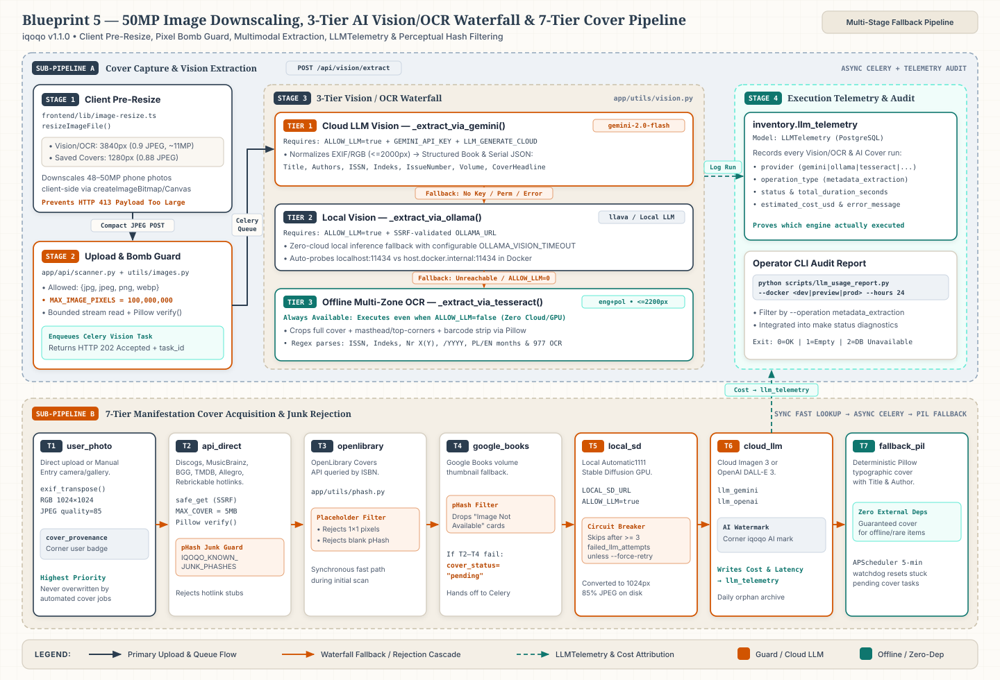

# Cover Generation & Retrieval Setup

iqoqo utilizes a multi-tiered fallback system to ensure every item in your distributed catalog has high-quality, normalized cover art. This guide explains how to configure external providers and local AI models.

* [The Pipeline Tiers](#the-pipeline-tiers)
* [Rate Limiting \& Storage](#rate-limiting--storage)
* [Cover Badges](#cover-badges)
* [1. External Metadata APIs](#1-external-metadata-apis)
* [2. Cloud AI Generation (Paid)](#2-cloud-ai-generation-paid)
  * [OpenAI (DALL-E 3)](#openai-dall-e-3)
  * [Google Gemini (Imagen 3)](#google-gemini-imagen-3)
* [2a. Vision-based Metadata Extraction & Offline Magazine OCR](#2a-vision-based-metadata-extraction--offline-magazine-ocr)
* [3. Local AI Generation (Free)](#3-local-ai-generation-free)
  * [Filtering Junk / Placeholder Covers](#filtering-junk--placeholder-covers)
* [4. Batch Processing & AI Cover Repair](#4-batch-processing--ai-cover-repair)
* [5. Troubleshooting](#5-troubleshooting)
* [6. Importing Covers to a Remote iqoqo Instance](#6-importing-covers-to-a-remote-iqoqo-instance)

## The Pipeline Tiers

When a new item is added, a background worker (`app/utils/covers.py`) processes covers in the following order:

1. **User Photo (`user_photo`)**: Direct upload from the user via the frontend UI.
2. **Direct Hotlink Download (`api_direct_download`)**: *[New in v0.2]* For Audio (CDs/Vinyl), external APIs like MusicBrainz or Discogs often return direct hotlinks. To bypass rate limits and prevent hotlinking decay, iqoqo intercepts these URLs, streams the image chunks securely, limits file sizes to 5MB, validates the bytes via Pillow, and saves a local copy.
3. **OpenLibrary API (`api_openlibrary`)**: Standard ISBN lookup.
4. **Google Books API (`api_google_books`)**: Search by ISBN fallback.
5. **Local LLM / Stable Diffusion (`llm_local_stable_diffusion`)**: Privacy-first AI generated cover based on metadata.
6. **Cloud LLM (`llm_gemini` / `llm_openai`)**: Opt-in cloud AI generation.
7. **Pillow Fallback (`fallback_pil`)**: A locally rendered flat image with the title/author text.

### Manifestation Supplementary Covers Gallery (`v1.2.0` C158)

In addition to a primary `Manifestation.cover_url`, curators and contributors can upload extra cover angles (back cover, inlay, disc, spine) via `POST /api/manifestations/<id>/images` (`catalog.image_scans`). `GET /api/manifestations/<id>/images` feeds `<ManifestationCoversGallery />` with a click-to-zoom lightbox on `/manifestation/[id]`.

## Rate Limiting & Storage

Because iqoqo now proactively downloads covers from MusicBrainz/Discogs (Tier 2):

* Images are stored in `app/static/covers/` (supplementary scans in `app/static/gallery/`).
* Mount persistent volumes to `/app/app/static/covers` and `/app/app/static/gallery` in Docker.
* Malicious payloads and pixel bombs are mitigated by `MAX_COVER_FILE_SIZE` (5MB) and `Image.MAX_IMAGE_PIXELS = 100_000_000`.

## Cover Badges

To maintain transparency in the catalog, downloaded or generated images receive a discrete badge in the bottom right corner (e.g., a Teal "C" for Direct Downloads, a Gray "D" for OpenLibrary).

## 1. External Metadata APIs

**OpenLibrary** requires no configuration.

**Google Books** works out of the box, but unauthenticated requests are subject to lower rate limits. To avoid `429 Too Many Requests` errors:

1. Go to the [Google Cloud Console](https://console.cloud.google.com/apis/credentials).
2. Create a project and enable the **Books API**.
3. Create an **API Key** (Credentials -> Create Credentials -> API Key).
4. Add the key to your `.env` file:

   ```bash
   GOOGLE_BOOKS_API_KEY=AIzaSy...
   ```

## 2. Cloud AI Generation (Paid)

To enable high-quality AI cover generation, obtain an API key from OpenAI or Google.

### OpenAI (DALL-E 3)

1. Get key from [platform.openai.com](https://platform.openai.com/api-keys).
2. Add to `.env`:

   ```bash
   OPENAI_API_KEY=sk-proj-...
   ```

### Google Gemini (Imagen 3)

1. Get key from [Google AI Studio](https://aistudio.google.com/api-keys).
2. Add to `.env`:

   ```bash
   GEMINI_API_KEY=AIza...
   ```

*Note: Telemetry for estimated costs is tracked in the `llm_telemetry` database table.*

## 2a. Vision-based Metadata Extraction & Offline Magazine OCR



iqoqo can extract metadata directly from a cover photo using the **Snap Cover** tab on `/scan` or the **Snap Cover to Auto-Fill Issue** action inside the serial disambiguation modal. Starting in `v1.1.0`, uploaded smartphone camera images (up to 50MP) are downscaled cleanly client-side (`frontend/lib/image-resize.ts` — `VISION_MAX_DIMENSION=3840` at JPEG quality `0.9` for crisp Vision/OCR glyphs; `COVER_MAX_DIMENSION=1280` for saved covers) and protected server-side (`Image.MAX_IMAGE_PIXELS = 100_000_000` in `app/utils/images.py`, normalized to `2000px` for Vision LLMs and `2200px` for OCR).

This feature uses a progressive 3-tier waterfall (`app/utils/vision.py`) to guarantee resilient extraction across books, vinyl sleeves, and periodicals:

1. **Gemini Vision API (Tier 1 — Cloud LLM):** High quality extraction (`gemini-2.0-flash`).
   * **Required:** `ALLOW_LLM=true`, `GEMINI_API_KEY`, and caller permission `LLM_GENERATE_CLOUD`.
2. **Local Vision LLM via Ollama (Tier 2 — Private Local AI):** Used when Gemini is unconfigured, forbidden, or fails.
   * **Required:** `ALLOW_LLM=true`, validated `OLLAMA_URL` (default: `http://localhost:11434`, with Docker `host.docker.internal` fallback), `OLLAMA_VISION_MODEL` (default: `llava`), and `OLLAMA_VISION_TIMEOUT`.
   * **Setup:** `ollama pull llava`
3. **Offline Multi-Zone Tesseract OCR (`eng+pol`, Tier 3 — Always Available):** Used when LLMs are disabled (`ALLOW_LLM=false`) or fail.
   * **Required:** `tesseract-ocr` (plus `tesseract-ocr-pol` for Polish periodicals, included in the Docker image) and `pytesseract`.
   * **Multi-Zone Magazine Pipeline:** Scans both the full cover and cropped masthead/corner zones to extract `Title`, `Authors`, `ISSN` (`XXXX-XXXX`), `Indeks`, `IssueNumber`, `CumulativeIssueNumber` (e.g., `12(342)`), `Volume`, `PublicationMonth` / `PublicationYear` (English & Polish month inflection support), `CoverHeadline`, and `977` OCR barcodes.
   * **Setup (macOS):** `brew install tesseract tesseract-lang`

**Execution Telemetry & Audit (`v1.1.0+`):** Every vision run across `gemini`, `ollama`, and `tesseract` writes a row to `llm_telemetry` (`operation_type="metadata_extraction"`). Operators can inspect which backend actually handled requests using:

```bash
python scripts/llm_usage_report.py --docker preview --hours 24
```

**API endpoints:**

* `POST /api/vision/extract` — Submit cover photo (`cover` multipart field: JPEG, PNG, or WebP) and return `202 Accepted` with `task_id`.
* `GET /api/vision/extract/<task_id>` — Poll extraction completion and retrieve extracted book/serial fields.

**Successful response (HTTP 200 on poll):**

```json
{
  "success": true,
  "data": {
    "Title": "National Geographic Polska",
    "Authors": [],
    "Publisher": "Burda Media Polska",
    "issn": "1507-5966",
    "indeks": "323357",
    "issue_number": "12",
    "volume": "26",
    "publication_year": 2025,
    "publication_month": 12,
    "cover_headline": "Sekrety oceanów"
  },
  "error": null
}
```

**Error response when all extraction methods fail (HTTP 503):**

```json
{
  "success": false,
  "data": null,
  "error": "Vision extraction failed. Fallback methods unconfigured or failed."
}
```

> **Note:** The endpoint enforces `Image.MAX_IMAGE_PIXELS = 100_000_000` (decompression-bomb protection) and bounded multipart size validation (`413 Payload Too Large` on oversized uploads). Only JPEG, PNG, and WebP images are accepted.

## 3. Local AI Generation (Free)

To use your own GPU (Nvidia or Apple Silicon, 10GB+ free disk) for Tier 5 cover generation via Automatic1111 Stable Diffusion WebUI (`--api` mode on port `7860`), follow the step-by-step installation guide in **[LOCAL_AI_SETUP.md](LOCAL_AI_SETUP.md)** and add the endpoint to `.env`:

```bash
LOCAL_SD_URL=http://localhost:7860
# Inside Docker containers pointing at the host: http://host.docker.internal:7860
```

### Filtering Junk / Placeholder Covers

Some external metadata APIs (like OpenLibrary or Google Books) occasionally return generic "No Image Available" placeholder images instead of an HTTP error. To prevent these from polluting your library, iqoqo uses perceptual hashing (`pHash`) to detect and reject them automatically, allowing the system to fall back to generating a custom LLM cover.

Because different regions and APIs have different placeholder images, you can define a custom blocklist using environment variables.

**How to block a generic cover:**

1. Save the annoying placeholder image to your computer (e.g., `junk_cover.jpg`).
2. Compute its pHash:

    ```bash
    # locally
    python scripts/phash_cover.py junk_cover.jpg

    # or inside the running container
    docker compose exec web python scripts/phash_cover.py /tmp/junk_cover.jpg
    ```

    This prints one hash per image, e.g. `e1e1e1e1e1e1e1e1  junk_cover.jpg`.

3. Add the hash to your `.env`:

    ```bash
    IQOQO_KNOWN_JUNK_PHASHES="e1e1e1e1e1e1e1e1,ffffffff00000000,eea4985b94846fe8"
    ```

    Entries must be exactly 16 hex characters. Anything else is ignored with a
    warning in the log rather than being silently reinterpreted.

### Hash stability

The hash is computed by `app/utils/phash.py`, on Pillow alone. It previously
came from the `imagehash` package, which required `numpy` and `scipy` — 167 MB
of the production image for a single function call — so it was replaced. The
algorithm is unchanged: the same image produces the same hash as before, and
`tests/test_phash.py` pins that against values captured from `imagehash` itself.

**Verify your existing hashes after upgrading:**

```bash
docker compose exec web python scripts/phash_cover.py --check junk_cover.jpg
```

This reports `blocked` if the image matches a configured hash. If a placeholder
you *did* block now reports `ACCEPTED`, recompute its hash with the command above
and replace the old entry.

There is one narrow caveat. For mathematically symmetric images — a perfect
cross, an exactly repeating pattern — several DCT coefficients tie exactly at
the median, and `imagehash`'s answer for those was decided by floating-point
rounding noise rather than arithmetic. The current implementation returns the
exact result, so a hash captured for such an image under the old code may no
longer match. The effect is limited: one placeholder cover is accepted and
displayed where it would previously have been rejected and replaced by a
generated cover. Recomputing the entry restores blocking. See
`KNOWN_DIVERGENCES` in `tests/test_phash.py` for the pinned scope.

## 4. Batch Processing & AI Cover Repair

To fetch/generate covers for existing items or verify AI-watermarked bindings (see also [`AI_COVERS.md`](AI_COVERS.md)):

```bash
# Resumable cover fetch batch (skip items that already have covers)
python scripts/fetch_covers.py --limit 100

# Generate AI covers & apply corner watermarks (circuits break after failed_llm_attempts >= 3)
python scripts/generate_ai_covers.py --batch-all-unwatermarked --limit 50
python scripts/generate_ai_covers.py --watermark-only --dry-run
# Override circuit breaker: --force-retry | Custom template: --prompt-spec PATH

# Verify & repair AI cover bindings against Manifestation rows
make fix-ai-covers
```

## 5. Troubleshooting

* **Missing Covers:** Check `app/static/covers/` permissions (`10001:10001` in Docker). Ensure Docker volumes are mounted correctly.
* **API Errors:** Check application logs for `"Cloud LLM Gen failed"` messages or inspect `make status`.

## 6. Importing Covers to a Remote iqoqo Instance

To transfer locally fetched/generated covers to a remote Docker deployment without re-querying providers:

1. **Package and Transfer (Local Machine):**

   ```bash
   tar -czvf covers.tar.gz -C app/static covers
   scp covers.tar.gz user@your-server-ip:/tmp/
   ```

2. **Extract & Align Ownership (Remote Server):**

   ```bash
   cd /opt/iqoqo
   tar -xzvf /tmp/covers.tar.gz -C app/static/
   chown -R 10001:10001 app/static/covers
   rm -f /tmp/covers.tar.gz
   ```

3. **Bind Imported Files to Database Rows (when importing unlinked files):**

   ```bash
   docker compose exec web python scripts/import_covers.py --dry-run
   docker compose exec web python scripts/import_covers.py
   ```
