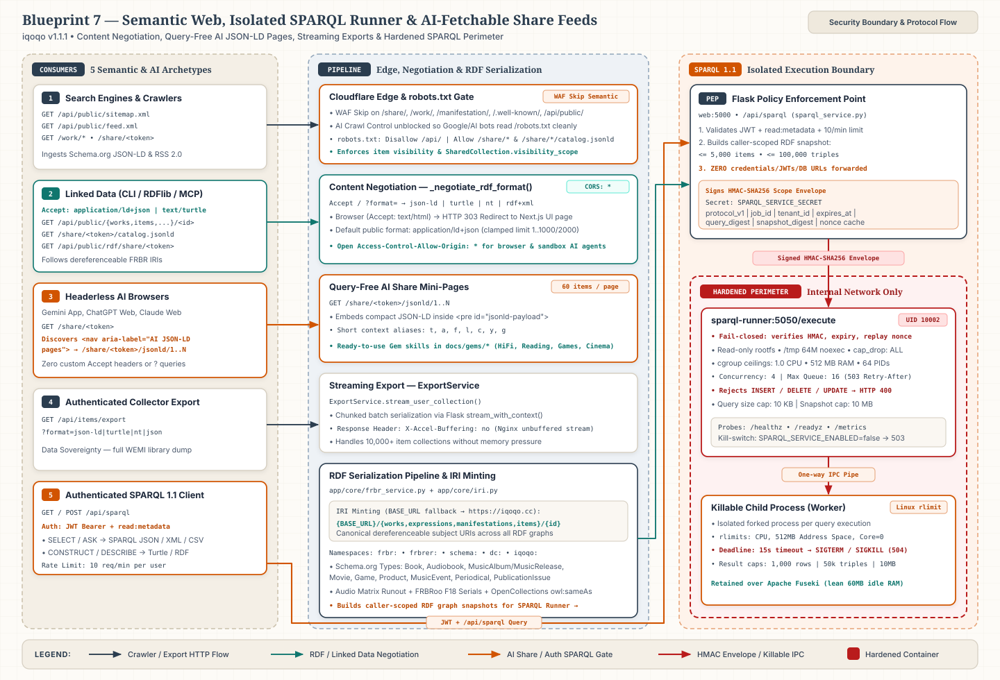

# 🌐 Semantic Web & Linked Open Data Guide

iqoqo provides a W3C Semantic Web layer that transforms your personal library into a queryable, interoperable Linked Data source. This guide covers SPARQL querying, public Linked Data endpoints, data export, Schema.org SEO, IRI minting, and content negotiation.



## SPARQL Query Endpoint

The SPARQL endpoint provides read-only access to your collection using the standard [SPARQL Protocol](https://www.w3.org/TR/sparql11-protocol/).

### Endpoint

```bash
GET  /api/sparql?query=<url-encoded-sparql>
POST /api/sparql
```

### Authentication

The SPARQL endpoint requires authentication and the `read:metadata` permission:

```bash
# Get a token
TOKEN=$(curl -s -X POST http://localhost:8000/api/auth/login \
  -H "Content-Type: application/json" \
  -d '{"email":"you@example.com","password":"your_password"}' \
  | python3 -c 'import sys,json;print(json.load(sys.stdin)["data"]["access_token"])')
```

### Query Examples

#### List All Works and Authors

```sparql
PREFIX dc: <http://purl.org/dc/terms/>
PREFIX frbr: <http://purl.org/vocab/frbr/core#>

SELECT ?title ?author
WHERE {
  ?work a frbr:Work ;
        dc:title ?title ;
        dc:creator ?author .
}
ORDER BY ?title
LIMIT 20
```

```bash
curl -G "http://localhost:8000/api/sparql" \
  --data-urlencode 'query=PREFIX dc: <http://purl.org/dc/terms/> PREFIX frbr: <http://purl.org/vocab/frbr/core#> SELECT ?title ?author WHERE { ?work a frbr:Work ; dc:title ?title ; dc:creator ?author . } ORDER BY ?title LIMIT 20' \
  -H "Authorization: Bearer $TOKEN" \
  -H "Accept: application/sparql-results+json"
```

#### Count Items by Format

```sparql
PREFIX schema: <https://schema.org/>
PREFIX frbr: <http://purl.org/vocab/frbr/core#>

SELECT ?format (COUNT(?item) AS ?count)
WHERE {
  ?item a frbr:Item ;
        frbr:exemplarOf ?manifestation .
  ?manifestation schema:bookFormat ?format .
}
GROUP BY ?format
ORDER BY DESC(?count)
```

#### Find Books by Publisher

```sparql
PREFIX dc: <http://purl.org/dc/terms/>
PREFIX schema: <https://schema.org/>
PREFIX frbr: <http://purl.org/vocab/frbr/core#>

SELECT ?title ?publisher ?isbn
WHERE {
  ?manifestation a frbr:Manifestation ;
        schema:publisher ?publisher ;
        schema:isbn ?isbn .
  ?manifestation frbr:embodimentOf ?expression .
  ?expression frbr:expressionOf ?work .
  ?work dc:title ?title .
  FILTER(CONTAINS(LCASE(?publisher), "penguin"))
}
```

#### CONSTRUCT a Sub-Graph

```sparql
PREFIX dc: <http://purl.org/dc/terms/>
PREFIX frbr: <http://purl.org/vocab/frbr/core#>

CONSTRUCT {
  ?work dc:title ?title ;
        dc:creator ?author .
}
WHERE {
  ?work a frbr:Work ;
        dc:title ?title ;
        dc:creator ?author .
  FILTER(CONTAINS(LCASE(?title), "hobbit"))
}
```

### POST Request Formats

The SPARQL endpoint accepts queries via POST in three formats:

```bash
# 1. application/sparql-query (raw SPARQL)
curl -X POST http://localhost:8000/api/sparql \
  -H "Authorization: Bearer $TOKEN" \
  -H "Content-Type: application/sparql-query" \
  -d 'SELECT * WHERE { ?s ?p ?o } LIMIT 5'

# 2. application/json
curl -X POST http://localhost:8000/api/sparql \
  -H "Authorization: Bearer $TOKEN" \
  -H "Content-Type: application/json" \
  -d '{"query": "SELECT * WHERE { ?s ?p ?o } LIMIT 5"}'

# 3. Form-encoded (SPARQL Protocol standard)
curl -X POST http://localhost:8000/api/sparql \
  -H "Authorization: Bearer $TOKEN" \
  -d "query=SELECT+*+WHERE+%7B+%3Fs+%3Fp+%3Fo+%7D+LIMIT+5"
```

### Resource Limits

| Parameter          | Limit   | Description                               |
| ------------------ | ------- | ----------------------------------------- |
| Query size         | 10 KB   | Maximum query string length               |
| Execution timeout  | 15 s    | Maximum query execution time              |
| Graph items        | 5,000   | Maximum items materialized into RDF graph |
| Graph triples      | 100,000 | Maximum triples in materialized graph     |
| Result rows        | 1,000   | Maximum SELECT result rows                |
| Result triples     | 50,000  | Maximum CONSTRUCT/DESCRIBE result triples |
| Concurrent queries | 4       | Maximum simultaneous expensive queries    |
| Rate limit         | 10/min  | Maximum queries per user per minute       |
| Result size        | 10 MB   | Maximum serialized response size          |

### Security Model

- **Read-only:** Write operations (`INSERT`, `DELETE`, `UPDATE`) are rejected with HTTP 400.
- **Resource isolation:** Queries execute in a subprocess with strict resource bounds.
- **Per-user scoping:** Each user sees only their own items plus public (non-hidden) items.
- **Graph size limits:** Prevents memory exhaustion from unbounded queries.

---

## Public Linked Data Endpoints

Public endpoints serve FRBR/Schema.org semantic metadata for individual entities without authentication. These are designed for AI agents, search engine crawlers, and Linked Data consumers.

### Endpoints

| Endpoint                              | Description                     |
| ------------------------------------- | ------------------------------- |
| `GET /api/public/works/<id>`          | Work entity as RDF              |
| `GET /api/public/expressions/<id>`    | Expression entity as RDF        |
| `GET /api/public/manifestations/<id>` | Manifestation entity as RDF     |
| `GET /api/public/items/<id>`          | Item entity as RDF (non-hidden) |

### Usage Examples

```bash
# Get a Work as JSON-LD (default)
curl http://localhost:8000/api/public/works/1

# Get a Manifestation as Turtle
curl -H "Accept: text/turtle" http://localhost:8000/api/public/manifestations/42

# Get an Item as N-Triples
curl "http://localhost:8000/api/public/items/7?format=nt"

# Get an Expression as Turtle via query parameter
curl "http://localhost:8000/api/public/expressions/3?format=turtle"
```

### CORS Headers

All public endpoints include open CORS headers for cross-origin access:

```text
Access-Control-Allow-Origin: *
Access-Control-Allow-Methods: GET, HEAD, OPTIONS
Access-Control-Allow-Headers: Content-Type, Accept, Authorization
```

### HTML Redirect

Browser requests (Accept: text/html) receive a 303 redirect to the frontend page:

```bash
# Browser request → redirects to /work/1
curl -H "Accept: text/html" -L http://localhost:8000/api/public/works/1
```

### Collection Feeds

Public RSS feeds are available for discovery:

```bash
# Global fresh arrivals
curl http://localhost:8000/api/public/feed.xml

# User collection feed
curl http://localhost:8000/api/public/u/username/feed.xml

# Shared collection feed
curl http://localhost:8000/api/public/share/TOKEN/feed.xml
```

### Rate Limits

Public entity endpoints are rate limited to 120 requests per minute. Feed endpoints allow 60 requests per minute.

---

## Data Sovereignty Export

Export your complete library in Linked Data or JSON formats. You own your data — export it anytime.

### Endpoint

```text
GET /api/items/export?format=<format>
```

**Authentication required.**

### Format Options

| Format    | Content-Type          | Extension | Description                          |
| --------- | --------------------- | --------- | ------------------------------------ |
| `json-ld` | `application/ld+json` | `.jsonld` | JSON-LD with FRBR/Schema.org context |
| `turtle`  | `text/turtle`         | `.ttl`    | RDF Turtle serialization             |
| `json`    | `application/json`    | `.json`   | Hierarchical JSON (FRBR structure)   |

### Usage Examples

```bash
# Export as JSON-LD (default)
curl -H "Authorization: Bearer $TOKEN" \
  -o my-library.jsonld \
  "http://localhost:8000/api/items/export"

# Export as Turtle
curl -H "Authorization: Bearer $TOKEN" \
  -o my-library.ttl \
  "http://localhost:8000/api/items/export?format=turtle"

# Export as hierarchical JSON
curl -H "Authorization: Bearer $TOKEN" \
  -o my-library.json \
  "http://localhost:8000/api/items/export?format=json"
```

### JSON-LD Context

The JSON-LD export includes a canonical `@context` mapping to standard vocabularies:

```json
{
  "@context": {
    "frbr": "http://purl.org/vocab/frbr/core#",
    "frbrer": "http://iflastandards.info/ns/frbr/frbrer/",
    "schema": "https://schema.org/",
    "dc": "http://purl.org/dc/terms/",
    "iqoqo": "https://iqoqo.org/ontology#",
    "Work": "frbr:Work",
    "Expression": "frbr:Expression",
    "Manifestation": "frbr:Manifestation",
    "Item": "frbr:Item",
    "title": "dc:title",
    "creator": "dc:creator",
    "isbn": "schema:isbn",
    "publisher": "schema:publisher"
  }
}
```

### Streaming

Exports use chunked streaming serialization, so even large collections (10,000+ items) are exported without memory pressure.

---

## Schema.org SEO Mappings

iqoqo automatically embeds Schema.org structured data in RDF serializations, enabling search engines to display rich snippets for your public collection.

### Type Mappings

| Content Type   | Schema.org Type                                                    |
| -------------- | ------------------------------------------------------------------ |
| `text`         | `schema:Book` (or `schema:Map` for maps)                           |
| `serial`       | `schema:Periodical` + `schema:PublicationIssue`                    |
| `audiobook`    | `schema:Audiobook`                                                 |
| `music`        | `schema:MusicAlbum` + `schema:MusicRelease`                        |
| `movie`        | `schema:Movie` (includes `vcd`)                                    |
| `board_game`   | `schema:Game`                                                      |
| `puzzle`       | `schema:Product`                                                   |
| `lego`         | `schema:Product`                                                   |
| `concert`      | `schema:MusicEvent`                                                |
| `cd_dvd_combo` | `schema:MusicAlbum` + `schema:Movie` (hybrid audio/video carrier)  |

### Audio Pressing, Serial Issue & Cross-Media Extensions (`v1.0.3`–`v1.2.0`)

- **Audio Pressing RDF Triples (`_emit_audio_rdf_triples()`):** Audio Manifestations emit paired `schema:MusicAlbum` / `schema:MusicRelease` descriptions carrying `schema:recordLabel`, `schema:catalogNumber`, `schema:gtin13`, `iqoqo:matrixRunout` (wax matrix etching), and `owl:sameAs` links to Discogs / MusicBrainz.
- **FRBRoo Serials (`F18_Serial_Work` & `PublicationIssue`):** Serial Works (`work_kind = "serial"`) emit `frbroo:F18_Serial_Work` and `schema:Periodical` alongside `schema:issn`, while each issue Manifestation emits `schema:PublicationIssue`, `schema:issueNumber`, `schema:volumeNumber`, and `schema:datePublished`.
- **Cross-Media Derivatives (`WorkRelation`):** Linked derivative Works emit `frbroo:R2_is_derivative_of` and `schema:isBasedOn` between canonical Work IRIs.
- **Owner-Authorized Physical Locations (`Item.physical_location`):** Under `enrichment_profile="full"` when requested by the authorized owner, physical copies emit `iqoqo:physicalLocation` and `schema:location`; public and anonymous serializations redact shelf locations.
- **OpenCollections.org LOD Bridge:** `OpenCollectionsLookupStrategy` reconciles records and emits `owl:sameAs`, `schema:sameAs`, and `rdfs:seeAlso` triples referencing canonical OpenCollections URIs.

### Properties Mapped

| FRBR Attribute     | Schema.org Property                    |
| ------------------ | -------------------------------------- |
| Title              | `schema:name`                          |
| ISBN-13            | `schema:isbn`                          |
| Publisher          | `schema:publisher`                     |
| Language           | `schema:inLanguage`                    |
| Publication Date   | `schema:datePublished`                 |
| Cover Image        | `schema:image`                         |
| Authors            | `schema:author` / `schema:contributor` |
| Board Game Players | `schema:numberOfPlayers`               |
| Concert Performers | `schema:performer`                     |
| Concert Date       | `schema:startDate`                     |
| Concert Location   | `schema:location`                      |

### Benefits

- **Rich Snippets:** Google displays book covers, ratings, and author info directly in search results.
- **Knowledge Panels:** Structured data enables knowledge panel entries for public collections.
- **AI Agent Discovery:** LLMs and AI agents can parse your collection semantics via standard vocabularies.
- **Linked Data Interoperability:** Other FRBR-aware systems can ingest your data without custom parsers.

### Sitemap

An XML sitemap is automatically generated at `/api/public/sitemap.xml` listing all public profiles, shared collections, and catalog entities for search engine indexing.

```bash
curl http://localhost:8000/api/public/sitemap.xml
```

---

## IRI Minting and BASE_URL Configuration

Every FRBR entity in iqoqo receives a canonical, dereferenceable Internationalized Resource Identifier (IRI).

### Configuration

Set the `BASE_URL` environment variable in your `.env` file:

```bash
# Production
BASE_URL=https://iqoqo.cc

# Local development (via Nginx gateway)
BASE_URL=http://localhost:8000

# Custom domain
BASE_URL=https://library.example.com
```

If not set, the default is `https://iqoqo.cc`.

### IRI Patterns

| Entity        | IRI Pattern                      | Example                              |
| ------------- | -------------------------------- | ------------------------------------ |
| Work          | `{BASE_URL}/works/{id}`          | `https://iqoqo.cc/works/42`          |
| Expression    | `{BASE_URL}/expressions/{id}`    | `https://iqoqo.cc/expressions/17`    |
| Manifestation | `{BASE_URL}/manifestations/{id}` | `https://iqoqo.cc/manifestations/99` |
| Item          | `{BASE_URL}/items/{id}`          | `https://iqoqo.cc/items/256`         |

### Usage in RDF

IRIs are used as subject URIs in all RDF serializations:

```turtle
@prefix frbr: <http://purl.org/vocab/frbr/core#> .
@prefix dc: <http://purl.org/dc/terms/> .

<https://iqoqo.cc/works/42> a frbr:Work ;
    dc:title "The Hobbit" ;
    dc:creator "J.R.R. Tolkien" .
```

### Fallback Chain

The IRI base URL resolves in this order:

1. `BASE_URL` environment variable
2. `NEXT_PUBLIC_FRONTEND_URL` environment variable
3. Default: `https://iqoqo.cc`

---

## Content Negotiation

iqoqo supports HTTP content negotiation for RDF formats via the `Accept` header and `?format=` query parameter.

### Supported Formats

| Format      | Accept Header                     | `?format=` Value | MIME Type                         |
| ----------- | --------------------------------- | ---------------- | --------------------------------- |
| JSON-LD     | `application/ld+json`             | `json-ld`        | `application/ld+json`             |
| Turtle      | `text/turtle`                     | `turtle`         | `text/turtle`                     |
| N-Triples   | `application/n-triples`           | `nt`             | `application/n-triples`           |
| SPARQL JSON | `application/sparql-results+json` | —                | `application/sparql-results+json` |
| SPARQL XML  | `application/sparql-results+xml`  | —                | `application/sparql-results+xml`  |
| CSV         | `text/csv`                        | —                | `text/csv`                        |
| TSV         | `text/tab-separated-values`       | —                | `text/tab-separated-values`       |
| RDF/XML     | `application/rdf+xml`             | —                | `application/rdf+xml`             |

### Examples

```bash
# Via Accept header
curl -H "Accept: text/turtle" http://localhost:8000/api/public/works/1

# Via query parameter
curl "http://localhost:8000/api/public/works/1?format=turtle"

# SPARQL results as CSV
curl -G "http://localhost:8000/api/sparql" \
  --data-urlencode "query=SELECT * WHERE { ?s ?p ?o } LIMIT 5" \
  -H "Authorization: Bearer $TOKEN" \
  -H "Accept: text/csv"
```

### Default Behavior

- **Public endpoints:** Default to JSON-LD when no preference is specified.
- **SPARQL SELECT/ASK:** Default to SPARQL results JSON.
- **SPARQL CONSTRUCT/DESCRIBE:** Default to Turtle.
- **Browser requests:** Public endpoints redirect (303) to the HTML frontend page.

---

## AI Agent Integration

iqoqo's Semantic Web layer is designed for AI agent and LLM integration.

### Discovering Collections

```bash
# Get sitemap for all public entities
curl http://localhost:8000/api/public/sitemap.xml

# Get fresh arrivals feed
curl http://localhost:8000/api/public/feed.xml

# Get user's public collection as JSON-LD
curl -H "Accept: application/ld+json" \
  http://localhost:8000/api/public/u/username/items
```

### Querying with SPARQL

AI agents can use SPARQL to ask structured questions about collections:

```sparql
# "What board games does this collection have?"
PREFIX schema: <https://schema.org/>
PREFIX frbr: <http://purl.org/vocab/frbr/core#>
PREFIX dc: <http://purl.org/dc/terms/>

SELECT ?title ?author
WHERE {
  ?work a frbr:Work ;
        dc:title ?title .
  ?expression frbr:expressionOf ?work .
  ?manifestation frbr:embodimentOf ?expression ;
        schema:bookFormat schema:Game .
  OPTIONAL { ?work dc:creator ?author }
}
```

### CORS for Cross-Origin Access

All public endpoints include `Access-Control-Allow-Origin: *` headers, allowing AI agents running in browsers or sandboxed environments to access Linked Data without proxy configuration.

### Privacy, Access Control & Shared Visibility Scopes

All SPARQL query execution snapshots and public RDF exports strictly enforce item-level, user-level, and share-link access rights:

- **Private items (`visibility='private'` or `is_hidden: true`)** are excluded from anonymous queries and default public RDF serializations.
- **Friends-Only (`visibility='friends_only'`)** items are exposed only to authenticated accepted local/federated friends, or via shared links configured to allow them.
- **Shared Collection `visibility_scope` & Friend Bonus:** Public RDF/JSON-LD shares (`/share/<token>`, `/share/<token>/catalog.jsonld`, `/share/<token>/jsonld/1..N`, `/api/public/rdf/share/<token>`) evaluate the token's stored `visibility_scope`:
  - `public_only` (default): anonymous visitors see `public` items only; signed-in accepted friends receive the **Friend Bonus** unlocking matching `friends_only` items.
  - `friends_and_public`: any token holder sees matching `public` and `friends_only` items (`private` stays hidden).
  - `all`: any token holder sees all matching items including `private` copies.
- **Federation Consent:** If an owner has opted out of public federation collection sharing (`federated_collection: false`), their items are omitted from public federated graph builds.
- **Authenticated Access:** Logged-in users can query their own items alongside public items, as well as items from accepted federated friends.

### Streaming for Large Collections

Use the `?stream=true` parameter for memory-efficient streaming of large collections:

```bash
curl "http://localhost:8000/api/public/u/username/items?format=json-ld&stream=true&limit=1000"
```

### Linked Data Crawling

Standard Linked Data crawlers can follow IRIs:

1. Start at a public entity: `GET /api/public/works/1` (Accept: text/turtle)
2. Parse the Turtle response to discover related IRIs
3. Follow `frbr:embodimentOf`, `frbr:expressionOf`, etc. to traverse the FRBR hierarchy
4. Each IRI is dereferenceable and returns RDF

### Ready-to-Use AI Agent & Gem Skill Templates

Collectors can pair public `/share/<token>` links with **Gemini Gems**, **ChatGPT Custom GPTs**, **Claude Projects**, or **CLI/MCP agents** using the ready-to-use Markdown templates in [`docs/gems/`](gems/):

| Template | Domain | Primary Protocol |
| :--- | :--- | :--- |
| [HiFi & Physical Music Advisor](gems/hifi-music-advisor-skill.md) | Vinyl, CD, SACD & HiFi setup | `/share/<token>/jsonld/1..N` + `Accept: application/ld+json` |
| [Reading Curator](gems/reading-curator-skill.md) | Books, Comics & Graphic Novels | `/share/<token>/jsonld/1..N` + `Accept: application/ld+json` |
| [Board Game & LEGO Sommelier](gems/boardgame-sommelier-skill.md) | Board Games, LEGO & Puzzles | `/share/<token>/jsonld/1..N` + `Accept: application/ld+json` |
| [Cinema & Video Games Archivist](gems/cinema-archivist-skill.md) | 4K UHD, Blu-ray, DVD & Games | `/share/<token>/jsonld/1..N` + `Accept: application/ld+json` |
| [iqoqo Librarian Gem](gems/iqoqo-librarian-gem.md) | Full private library + loans/wishlist | PAT OpenAPI Actions + `/share/<token>/jsonld/1..N` |

**Browser Agents vs. Header-Capable Clients:**

- **Headerless Browser Agents (`Gemini App`, `ChatGPT Web`, `Claude Web`):** Instruct the agent to open `/share/<token>`, discover query-free `/share/<token>/jsonld/1` through `/share/<token>/jsonld/<N>` links (`60` items/page) from `<nav aria-label="AI JSON-LD pages">` / `<nav aria-label="JSON-LD Pages">`, and read `<pre id="jsonld-payload">` (`t`, `a`, `f`, `l`, `c`, `y`, `g`) without inventing `?` query parameters.
- **Header-Capable Clients (CLI, MCP, Custom Actions):** Request `GET /share/<token>` with `Accept: application/ld+json` (or `text/turtle`), `/share/<token>/catalog.jsonld`, or `/api/public/rdf/share/<token>?format=jsonld&limit=2000`.

---

## 📚 Further Reading

- **[API Reference](API.md)** — Complete endpoint documentation
- **[Architecture Guide](ARCHITECTURE.md)** — Semantic Web layer architecture
- **[Operations Runbook](OPERATIONS.md)** — FRBR ETL and ontology sync scripts
- **[Upgrade Guide](archive/UPGRADE_0.8.0.md)** — Historical v0.8.0 migration notes
- **[SPARQL Tutorial](tutorials/sparql-queries.md)** — Step-by-step SPARQL tutorial
- **[Linked Data Tutorial](tutorials/linked-data-integration.md)** — Integration examples
