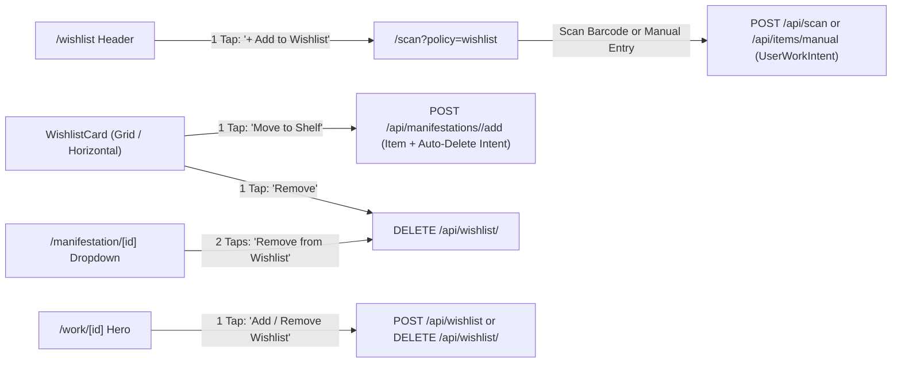

## Context

`wishlist-api-separation` separated wishlist intents (`UserWorkIntent`, exposed at `/api/wishlist` with positive integer IDs) from physical library items (`Item`, exposed at `/api/items`) and banned negative virtual item IDs (`/api/items/-<id>`). However, several backend endpoints and frontend components retained assumptions from the legacy virtual-item model or omitted `UserWorkIntent` lifecycle wiring.

### UX Audit: Full-Page DOM Layout Snapshot

```text
document
└── body.min-h-screen.bg-background
    ├── header <Navbar />
    ├── main.mx-auto.max-w-7xl.px-4.py-8 (/wishlist)
    │   ├── div.mb-6.flex.items-center.justify-between (Header Container — 1 Primary CTA)
    │   │   ├── div (h1 "Wishlist" + item count subtitle)
    │   │   └── a.btn-primary[href="/scan?policy=wishlist"] "+ Add to Wishlist"
    │   ├── div.mb-6.flex.flex-wrap.gap-3 (Search + Category Filter + Sort Bar — 3 controls)
    │   │   ├── input[type="search" placeholder="Search wishlist..."]
    │   │   ├── select[aria-label="Filter by category"]
    │   │   └── select[aria-label="Sort wishlist"]
    │   └── div.grid.grid-cols-2.sm:grid-cols-3.lg:grid-cols-4
    │       └── article <WishlistCard variant="grid" | "horizontal">
    │           ├── a[href="/manifestation/<id>" | "/work/<work_id>"] (Cover + Metadata link)
    │           └── div.action-cluster (2 touch-accessible action buttons — <= 4 button density ceiling)
    │               ├── button[aria-label="Move to library"] (Acquires physical Item & auto-deletes intent)
    │               └── button[aria-label="Remove from wishlist"] (Deletes intent via DELETE /api/wishlist/<id>)
    │
    ├── main (/manifestation/[id] when item is on Wishlist)
    │   └── <ManifestationActions>
    │       └── <AddToCollectionDropdown wishlistItemId={intent.id}>
    │           └── ul[role="menu"]
    │               ├── button "Add to My Library" (POST /api/manifestations/<id>/add + auto-deletes intent)
    │               ├── button "View Wishlist" -> router.push("/wishlist")
    │               └── button.text-destructive "Remove from Wishlist" -> DELETE /api/wishlist/<intent.id>
    │
    └── main (/work/[id] Conceptual Work Hero)
        └── div.work-actions (1 toggle button)
            └── button "Add to Wishlist" | "Remove from Wishlist" -> POST /api/wishlist | DELETE /api/wishlist/<id>
```

### Interaction Friction Map



## Goals / Non-Goals

- **Goals:**
  - Eliminate the `/item/-<id>` 404 dead link on `/manifestation/[id]` and provide a direct `"Remove from Wishlist"` action in `AddToCollectionDropdown`.
  - Make `WishlistCard` actions (`"Move to Shelf"` and `"Remove from Wishlist"`) touch-accessible on both `grid` and `horizontal` variants while staying within the $\le 4$ button density limit, and link work-only wishlist cards to `/work/${item.work_id}`.
  - Provide a primary `"+ Add to Wishlist"` CTA ($\to$ `/scan?policy=wishlist`) and search/category/sort filtering on `/wishlist`.
  - Auto-fulfill (delete) matching `UserWorkIntent(user_id, work_id)` rows whenever a physical `Item` (`collection_status != "wish_list"`) is created for that work across all item-creation and scanner endpoints.
  - Ensure `add_items_bulk` and `add_item_manual` route `collection_status == "wish_list"` to `UserWorkIntent` on all instances and preserve `expression_id` and `manifestation_id` on manifestation-scoped wishlist additions.
  - Wire a work-level wishlist toggle button on `/work/[id]` (`WorkDetailClient`).
  - Invalidate `["wishlist"]` across all relevant mutations so `/wishlist` and Dashboard `CurrentContext` update immediately.
- **Non-Goals:**
  - No database schema migrations (all columns `work_id`, `expression_id`, `manifestation_id`, `status` already exist on `user_work_intents`).
  - No reintroduction of negative virtual item IDs on `/api/items`.

## Decisions

### 1. Positive `wishlist_item_id` on Manifestation Detail & Dropdown Removal Action
- **Decision:** In `app/api/manifestations.py` (`get_manifestation_detail`), change `wishlist_item_id = -intent.id` to `wishlist_item_id = intent.id` (positive integer). In `AddToCollectionDropdown` (`frontend/components/collection/add-to-collection-dropdown.tsx`), when `wishlistItemId` is present (positive or normalized with `Math.abs(wishlistItemId)` for defensive compatibility):
  1. Render `"View Wishlist"` navigating to `/wishlist` (instead of `/item/${wishlistItemId}`).
  2. Render `"Remove from Wishlist"` calling `DELETE /api/wishlist/${Math.abs(wishlistItemId)}`, invalidating `["wishlist"]`, `["manifestations"]`, `["works"]`, `["items"]`, and `["stats"]`.

### 2. Auto-Fulfill `UserWorkIntent` When Acquiring a Physical Item
- **Decision:** Introduce a helper `_fulfill_wishlist_intent_for_manifestation(user_id: uuid.UUID, manifestation: Manifestation | None)` in `app/api/items.py` (and call equivalent logic in `app/api/scanner.py` `_scan_to_library`) that deletes any `UserWorkIntent` matching `(user_id=user_id, work_id=work.id)` when a physical `Item` (`collection_status != "wish_list"`) is created.
- **Rationale:** Matches collector mental model confirmed during design review: once a physical copy is added to the shelf (via `WishlistCard` `"Move to Shelf"`, `AddToCollectionDropdown` `"Add to My Library"`, Scanner in `inventory` mode, Bulk Add, or Manual Entry), the wishlist intent is fulfilled and must not remain as a duplicate ghost entry on `/wishlist`.

### 3. Unified `UserWorkIntent` Routing & Edition Binding for Wishlist Additions
- **Decision:**
  - Update `_add_wishlist_by_manifestation` (`app/api/items.py`) and `_scan_to_wishlist` (`app/api/scanner.py`) to set `expression_id=manifestation.expression_id` and `manifestation_id=manifestation.id` when creating `UserWorkIntent`, and if an intent for `(user_id, work.id)` already exists without `manifestation_id`, update its `expression_id` and `manifestation_id`.
  - In `add_items_bulk` (`app/api/items.py`), remove the `and is_federation_head_mode()` restriction on `if payload.collection_status == "wish_list":` so bulk-adding with `"Want to Read / Listen / Watch / Play"` always creates/updates `UserWorkIntent` rows on all instances.
  - In `add_item_manual` (`app/api/items.py`), check `if payload.collection_status == "wish_list":` before `reject_if_federation_head_item_write()` and route to `_add_wishlist_by_manifestation(user_id, manifestation, ...)` after resolving/creating the FRBR `Work -> Expression -> Manifestation` chain.
  - In `ScanPage` (`frontend/app/scan/page.tsx`), initialize `policy` from `?policy=wishlist` search param when present, and pass `collection_status: policy === "wishlist" ? "wish_list" : "available"` in `handleManualSubmit`, navigating to `/wishlist` (or `/manifestation/${manifestation_id}`) when a manual entry is saved to the wishlist.

### 4. Touch-Accessible `WishlistCard`, `/wishlist` Controls & `/work/[id]` Wishlist Toggle
- **Decision:**
  - In `WishlistCard` (`frontend/components/collection/wishlist-card.tsx`):
    - Fix `targetHref`: `item.manifestation_id ? `/manifestation/${item.manifestation_id}` : `/work/${item.work_id}``.
    - Expose 2 touch-accessible action buttons on both `grid` and `horizontal` variants:
      1. **Move to Shelf (`Acquire`)**: If `item.manifestation_id` is set, calls `POST /api/manifestations/${item.manifestation_id}/add` with `{ collection_status: "available" }` (which creates the physical `Item` and auto-deletes the `UserWorkIntent`), invalidates `["wishlist"]`, `["items"]`, `["stats"]`, `["manifestations"]`, and shows a toast with an option/navigation; if work-only (`!item.manifestation_id`), navigates to `/work/${item.work_id}` so the user can pick an edition.
      2. **Remove from Wishlist (`HeartOff`)**: Always visible on touch screens (`opacity-100 sm:opacity-85 sm:group-hover:opacity-100`), calling `useDeleteWishlistItem()`.
  - In `WishlistPage` (`frontend/app/wishlist/page.tsx`):
    - Add header Primary CTA `"+ Add to Wishlist"` linking to `/scan?policy=wishlist`.
    - Add compact search input (`q`), category selector (`category`), and sort selector (`sort`) wired to `useWishlist({ q, category, sort })`.
    - Add empty-state actions (`"+ Add to Wishlist"` and `"Browse Catalog"`).
  - In `WorkDetailClient` (`frontend/components/work/work-detail-client.tsx`):
    - Query `useWishlist` (or `useWorkIntent(work.id)`) when authenticated and render a single `"Add to Wishlist"` / `"On Wishlist · Remove"` toggle button in the Work hero section.

## Risks / Trade-offs

- **Existing tests expecting `wishlist_item_id` or `add_items_bulk` behavior:** Any test asserting negative `wishlist_item_id` on manifestation detail or physical `Item` creation when `collection_status="wish_list"` in `add_items_bulk` / `add_item_manual` will be updated to assert positive `intent.id` and `UserWorkIntent` creation.
